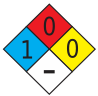
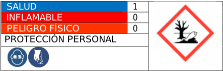
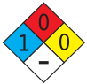

<!-- pagina 1 -->

142

> Texto OCR de la imagen: TECNIS-DECOR *

## HOJA DE SEGURIDAD PINTURA ANTIDESLIZANTE PARA CANCHAS DEPORTIVAS

Página 1 de 3

## 1. IDENTIFICACION DEL FABRICANTE Y DE LA SUBSTANCIA QUIMICA

Empresa:

Nit:

TECNIDECOR S.A.S

900112215-2

Pbx:

444 49 44

Nombre del Producto: PINTURA ANTIDESLIZANTE PARA CANCHAS DEPORTIVAS

Código del producto:

142

Sinónimos:

N/A

Fórmula:

RESINAS ACRILICAS BASE AGUA

Número UN:

N/D

Clase UN:

1-0-0

Fecha de actualización: Octubre de 2018

## 2. COMPOSICION, INFORMACION SOBRE INGREDIENTES

|   N° | SUSTANCIA       | NUMERO CAS   | NUMERO ONU   |
|------|-----------------|--------------|--------------|
|    1 | NIVELADOR DE PH | 7664-41-7    | 1005         |
|    2 | RESINA ACRILICA | 9002-89-5    | N/A          |
|    3 | CARGAS INERTES  | 13463-67-7   | N/A          |

## 3. IDENTIFICACION DE RIESGOS

Rótulo NFPA: 1-0-0

Condiciones que deben evitarse: luz directa, calor y humedad

Dispersión acuosa de polímero vinil acrílico con cargas (ninguno de sus componentes están clasificados como peligrosos).

Contacto con los ojos: Este producto puede causar irritación de los ojos. El contacto directo con el líquido o la exposición a los vapores puede causar enrojecimiento, lagrimeo, picazón, ardor, y enrojecimiento.

Contacto con la piel: No se prevé que este producto sea irritante de la piel. Sin embargo, si se deja permanecer en la piel sin enjuagarlo con agua, puede formarse una película delgada. Si se quita esta película puede causar irritación leve dependiendo del método de remoción. La inflamación de la piel se caracteriza por picazón, descamación, enrojecimiento, o, en ocasiones, formación de ampollas. Es improbable que la piel absorba este producto.

Inhalación: Respirar altas concentraciones de vapores o aerosoles de este material puede causar náuseas, dolor de cabeza e irritación de la nariz, garganta y vías respiratorias.

Ingestión: Aunque este producto tiene un bajo grado de toxicidad, la ingestión de cantidades excesivas puede causar irritación del aparato digestivo.

Salud 1 - Inflamabilidad 0 Reactividad 0.

> Texto OCR de la imagen: SALUD INFLAMABLE $s s<$ $s PROTECCION PERSONAL

## 4. PRIMEROS AUXILIOS

Inhalación: Trasladar al aire fresco. Si no respira administrar respiración artificial. Si respira con dificultad suministrar oxígeno. Mantener a la víctima abrigada y en reposo. Buscar atención médica inmediatamente. Ingestión: Lavar la boca con abundante agua. Si está consciente, suministrar abundante agua. No inducir el vómito. Buscar atención médica inmediatamente. Piel: Retirar la ropa y calzado contaminados. Lavar la zona afectada con abundante agua y jabón, mínimo durante 15 minutos. Si la irritación persiste repetir el lavado. Buscar atención médica de inmediato.

<!-- pagina 2 -->

142

> Texto OCR de la imagen: TECNIS-DECOR *

## HOJA DE SEGURIDAD PINTURA ANTIDESLIZANTE PARA CANCHAS DEPORTIVAS

Página 2 de 3

Ojos: Lavar con abundante agua, mínimo durante 15 minutos. Levantar y separar los párpados para asegurar la remoción del químico. Si la irritación persiste repetir el lavado. Buscar atención médica especializada.

Nota para los médicos: Después de proporcionar los primeros auxilios, es indispensable la comunicación directa con un médico especialista en toxicología, que brinde información para el manejo médico de la persona afectada, con base en su estado, los síntomas existentes y las características de la sustancia química con la cual se tuvo contacto

## 5. COMBATE DE INCENDIOS

| Punto de inflamación (ºC):          | N/A                                                                                                                                                                                            |
|-------------------------------------|------------------------------------------------------------------------------------------------------------------------------------------------------------------------------------------------|
| Temperatura de auto ignición (ºC):  | N/A                                                                                                                                                                                            |
| Límites de inflamabilidad (%V/V):   | N/A                                                                                                                                                                                            |
| Peligros de incendio y/o explosión: | No combustible, ni inflamable. El envase metálico al ser sometido a un sobrecalentamiento sobre 90º C, su contenido puede ocasionar sobrepresión interior originando una explosión de vapores. |
| Medios de extinción:                | Si el producto es sometido al fuego o calor intenso, aplicar agua en forma de roció para refrigerar.                                                                                           |
| Productos de la combustión:         | ND                                                                                                                                                                                             |

## 6. LIBERACIONES ACCIDENTALES

Precauciones ambientales: No verter en desagües ni cursos de agua. Limpiar inmediatamente cualquier vertido accidental. Técnica de contención: Absorba los residuos con material inerte, como arenas, sílices o tierras. Si el derrame es abundante, aísle el derrame con un dique o arena y bombee a un recipiente. Proceda a llamar a las autoridades locales responsables. Técnica de limpieza: Proceda a recoger el material, vertiéndolo en un recipiente debidamente rotulado y etiquetado como material de desecho. Cerrar y sellar adecuadamente el recipiente

## 7.MANEJO Y ALMACENAJE

Manipulación: Usar siempre protección personal así sea corta la exposición o la actividad que realice con el producto. Mantener estrictas normas de higiene, no fumar, ni comer en el sitio de trabajo. Conocer ubicación de equipo de lavado (lava ojos). Leer las instrucciones de la etiqueta antes de usar el producto. Rotular los recipientes adecuadamente. Almacenamiento: Lugares ventilados, frescos y secos, temperatura ambiente, lejos de la humedad. Lejos de fuentes de calor e ignición. Rotular los recipientes adecuadamente. El arrume para para cuñetes debe ser de 3 tendidos, para baldes 4 tendidos, para galones de 4 tendidos y para cuartos de 6 tendidos.

## 8. CONTROLES DE EXPOSICION, PROTECCION PERSONAL

Protección de los ojos: Use gafas de seguridad. Cuando haya riesgo de salpicadura, se recomienda utilizar monogafas, si los vapores molestan la vista, use facial completa.

Protección para la piel: Use guantes, use bata manga larga, delantal de caucho y botas de caucho.

Protección respiratoria: Para exposiciones cortas se debe usar mascaras con filtros para vapores, en espacios confinados o en situaciones donde continuamente hay operaciones de rociado, o si la propia respiración se dificulta debe usarse un equipo autónomo.Controles de Ingeniería

## 9. PROPIEDADES FISICAS Y QUIMICAS.

Estado físico

Punto de ebullición Liquido espeso N/A

Olor Característico vinílico

pH

8-9

Presión de vapor N/A

T de inflamabilidad N/A

Solubilidad en agua Soluble en agua

<!-- pagina 3 -->

142

> Texto OCR de la imagen: TECNIS-DECOR *

## HOJA DE SEGURIDAD PINTURA ANTIDESLIZANTE PARA CANCHAS DEPORTIVAS

Página 3 de 3

## 10. ESTABILIDAD Y REACTIVIDAD

Estabilidad: el producto es estable a temperatura ambiente en recipientes cerrados y bajo condiciones normales de manipulación.

Reactividad: No registra.

Condiciones a Evitar: Luz solar directa,.

## 11. INFORMACION TOXICOLOGICA.

Experiencia sobre personas

Contacto con la piel: Puede causar irritación

Contacto con los ojos: Puede causar irritación

Inhalación: Puede causar irritación

Ingestión: Puede causar perturbaciones en la salud

## 12. INFORMACION ECOLOGICA.

No permitir el paso al alcantarillado, cursos de agua o terrenos.

## 13. CONSIDERACIONES SOBRE LA DISPOSICION.

Eliminar según las normas locales.

Producto curado, completamente endurecido, puede ser desechado como escombro en escombreras autorizadas.

Envases/embalajes: si están totalmente vacíos pueden destinarse a reciclaje. Envases/embalajes que no pueden ser limpiados deben ser eliminados de la misma forma que la sustancia contenida.

## 14. INFORMACION SOBRE EL TRANSPORTE.

Número de ONU: N.A

Designación oficial de transporte: No regulado

Clase relativas al transporte: No regulado.

Grupo de embalaje: No regulado.

## 15. INFORMACION SOBRE REGLAMENTACION.

Los requerimientos sobre regulación, están sujetos a cambios y pueden diferir de una localidad a otra. Es responsabilidad del usuario asegurarse que todas sus actividades cumplan con la normatividad nacional, regional y local.

## 16. OTRA INFORMACION.

Esta hoja de seguridad tiene como fin sólo a brindar una guía basada en la Norma NTC 4435. Para el manejo del material con la precaución apropiada Las personas que reciban la información deben ejercer su propio criterio para determinar la conveniencia del uso de este producto para un fin específico. TECNIDECOR S.A.S no se hace responsable de ningún daño causado a propiedades o a personas por el uso inadecuado de nuestros productos, ya que no conocemos la manipulación ni las precauciones que cada cliente tiene en el almacenamiento.
