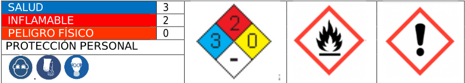

<!-- pagina 1 -->

100

## HOJA DE SEGURIDAD ESMALTE POLIURETANO

Página 1 de 4

## 1. IDENTIFICACIÓN DEL FABRICANTE Y DE LA SUSTANCIA QUÍMICA

Empresa:

Nit:

TECNIDECOR S.A.S

900112215-2

Pbx:

444 49 44

Nombre del Producto: ESMALTE POLIURETANO

Código del producto:

100

Sinónimos:

N/A

Fórmula:

Resinas, pigmentos, aditivos y solventes

Número UN:

1263

Clase UN:

3

Fecha de actualización: Octubre de 2018

## 2. COMPOSICION, INFORMACION SOBRE INGREDIENTES

| COMPONENTE            | NUMERO CAS    | %        |
|-----------------------|---------------|----------|
| POLIOL ACRILICO       | NO DISPONIBLE | 36 AL 50 |
| HIDOCARBURO AROMATICO | 123-86-4      | 20 AL 25 |
| ESTER                 | 1330-20-7     | 20 AL 23 |
| ADITIVOS              | NO DISPONIBLE | 1        |

## 3. IDENTIFICACIÓN DE RIESGOS

Inflamable, posibilidad de sensibilización en contacto con la piel, contiene isocianatos. Se puede incendiar fácilmente por calor, chispas o llamas. Los vapores pueden formar mezclas explosivas con el aire. Los vapores pueden causar mareos o sofocación. La inhalación o el contacto con el material pueden irritar o quemar la piel y los ojos.

EFECTOS DE SOBREEXPOSICIÓN AGUDA POR UNA VEZ: Irritaciones gastrointestinales, Irritaciones al sistema respiratorio que pude ser agravado por enfermedades preexistentes como asma, problemas en el sistema nervioso central, puede producir depresión, fatigas, náuseas, dolores de cabeza e inconsciencia.

INHALACIÓN: Los vapores pueden causar mareos o sofocación, irritación aparato tracto-respiratorio.

CONTACTO CON LA PIEL: La sobre exposición puede causar irritación a la piel. (Dermatitis)

CONTACTO CON LOS OJOS: La sobre exposición puede causar irritación a los ojos.

INGESTIÓN: Bajo orden de toxicidad, pero si una pequeña cantidad del líquido o parte del vómito ingresan a los pulmones, pueden causar bronconeumonía o un edema pulmonar.

Peligros para el medio ambiente: Posible contaminación de las aguas por hidrocarburos. El producto puede formar una película sobre la superficie del agua e impedir el intercambio de oxígeno. c)

> Texto OCR de la imagen: SALUD INFLAMABLE PELIGRO FÍSICO fo | | PROTECCION PERSONAL ©O@

## 4. PRIMEROS AUXILIOS

En caso de contacto accidental con el producto, proceder de acuerdo con:

INALHACIÓN: Retire a la víctima al aire fresco, aléjela de la zona de peligro, solicite ayuda médica.

<!-- pagina 2 -->

> Texto OCR de la imagen: 100 Tecnidecor

CONTACTO CON LA PIEL: Lave con jabón (glicerina) y abundante agua, remueva la ropa contaminada.

CONTACTO CON LOS OJOS: Lave con bastante agua corriente por 15 minutos. Si la irritación persiste consulte al médico.

INGESTIÓN: Consultar inmediatamente al médico. Llevar la HDS, no provocar el vómito.

EFECTOS AGUDOS PREVISTOS: Depresión del Sistema Nervioso Central, con síntomas como jaquecas, mareos y vómitosSi después del lavado observa alguna anormalidad, consulte al médico. Remover la ropa contaminada y lavarla antes de ser nuevamente usada. En caso de enrojecimiento, ardor intenso o formación de ampollas, remitir al médico.

EFECTOS RETARDADOS PREVISTOS: No disponible. SINTOMAS/EFECTOS MÁS IMPORTANTES: No disponible PROTECCIÓN DE QUIENES BRINDAN PRIMEROS AUXILIOS: Usar guantes de procedimiento de Nitrilo-Butilo

Notas para el médico tratante: Llevar la Hoja de Datos de Seguridad

## 5. COMBATE DE INCENDIOS

AGENTES DE EXTINCIÓN : Polvo químico seco, CO2, espuma AFFF PROCEDIMIENTOS ESPECIALES PARA COMBATIR EL FUEGO: La niebla de agua puede no ser efectiva, mantenga el viento a sus espaldas, refrigere los contenedores expuestos. Los envases, incluso vacíos, expuestos al fuego o temperaturas superiores a 50°C. pueden estallar. PRODUCTOS QUE SE FORMAN EN LA COMBUSTIÓN Y DEGRADACIÓN TÉRMICA: Monóxido de Carbono y Dióxido de Carbono. PELIGROS ESPECIFICOS ASOCIADOS: No disponible EQUIPOS DE PROTECCIÓN PERSONAL PARA EL COMBATE DEL FUEGO: Uso de equipos de respiración autónoma ERA, de presión positiva. El uso de uniforme estándar dará protección limitada.

## 6. LIBERACIONES ACCIDENTALES

## MEDIDAS A TOMAR SI HAY DERRAME DEL MATERIAL:

- Mantenga la gente innecesaria alejada del lugar; aísle el área de trabajo y no permita el ingreso.
- Desconecte las fuentes de ignición
- Evite fuegos, llamas o fumar en el área de riesgo.
- Ventilar el área del derrame

## EQUIPO DE PROTECCIÓN PERSONAL PARA CONTROLAR LA EMERGENCIA.

- Guantes de Nitrilo-Butilo
- Botas de goma ·

Protección respiratoria con filtros para vapores orgánicos.

- Equipo de respiración autónoma (ERA) de presión positiva con traje nivel B en caso de ser un derrame mayor, sobre 100 lts.

## PRECAUCIONES A TOMAR PARA EVITAR DAÑOS AL AMBIENTE

Evite que los derrames lleguen a las alcantarillas, se puede crear riesgo de incendio y/o explosión. Métodos de limpieza: Use material absorbente e incombustible.

## 7.MANEJO Y ALMACENAJE

CONDICIONES DE MANIPULACIÓN: RECOMENDACIONES TÉCNICAS: Almacenar en áreas limpias, frías y bien ventiladas; almacenar en áreas lejos del calor, fuentes de ignición o agentes oxidantes.

PRECAUCIONES A TOMAR: No fumar en áreas de almacenamiento, utilizar herramientas antichispas; para el trasvasije proveer un cable de interconexión para disipar las chispas estáticas.

RECOMENDACIONES SOBRE MANIPULACIÓN SEGURA Y ESPECÍFICA: Los recipientes vacíos pueden retener residuos peligrosos (vapor o líquido)

<!-- pagina 3 -->

CONDICIONES DE ALMACENAMIENTO: Áreas limpias, frías y bien ventiladas. S

USTANCIAS Y MEZCLAS INCOMPATIBLES: Corrosivos, Comburentes y Peróxidos.

## 8. CONTROLES DE EXPOSICIÓN, PROTECCIÓN PERSONAL

Medidas para reducir la posibilidad de exposición: Los lugares de manipulación del producto deben contar con ventilación

(natural o forzada) Parámetros para control: Límites permisible ponderado 1100 mg/m3 Límites permisibles absolutos: No aplica Protección respiratoria: Respirador para vapores orgánicos. Guantes de protección: Use guantes de neopreno o nitrilo butilo. Protección de la vista : Use anteojos de protección química. Otros equipos de protección: Delantal de PVC para protección corporal. Ventilación: Debe ser buena en los lugares de manipulación

## 9. PROPIEDADES FÍSICAS Y QUÍMICAS.

Estado físico: Líquido Apariencia y olor: Olor fácilmente perceptible a hidrocarburo. Color: No aplica Concentración: 41.47% de sólidos PH: 7-8 Punto de fusión: -58 °C Punto de ebullición: 175-270 °C Temperatura de descomposición: No disponible Punto de inflamación: Mayor a 26° °C. Temperatura de autoignición: 236 C°

## Propiedades inflamables:

Límite inferior de inflamabilidad: 1.2% Límite superior de inflamabilidad: 6% Peligros de fuego o explosión: Los vapores pueden extenderse un largo trecho, encender y retroceder. Presión de vapor a 20ºC: 6,7 mbar Densidad de vapor: 3,67 Densidad a 20ºC: 0,87 - O,95 gr/ml. Umbral del olor: 100 ppm Tasa de evaporación: 13 (AC. Butilo=100) Inflamabilidad: No disponible. Viscosidad: 0-55 ku Solubilidad en agua y otros solventes: Insoluble en agua. Soluble en solventes

## 10. ESTABILIDAD Y REACTIVIDAD

Estabilidad: El producto es estable bajo condiciones normales Restricciones: Evitar las descargas de corriente estática Incompatible: Agentes oxidantes fuertes

## 11. INFORMACIÓN TOXICOLÓGICA.

Dosis y concentraciones letales: No conocidas. Toxicidad oral aguda: Baja toxicidad: LD50 &gt; 5000mg/Kg, Ratas Toxicidad dérmica aguda: Baja toxicidad: LD50 &gt; 2000 mg/Kg, Conejos Toxicidad aguda por inhalación: Baja toxicidad: LC50&gt; 5mg/l/4h, Ratas Irritación/corrosión cutánea: Irritación de la piel, en casos extremos. Lesiones oculares/irritación: Irritación en ojos Sensibilización respiratoria o cutánea: No se produce

<!-- pagina 4 -->

> Texto OCR de la imagen: 10 | Tecnidecor

## HOJA DE SEGURIDAD ESMALTE POLIURETANO

Mutagenicidad de células reproductoras: Carcinogenicidad: Toxicidad reproductiva: Toxicidad específica en órganos:

Particulares-exposición única:

Particulares-exposiciones repetitivas: Peligro de Inhalación:

No se espera que perjudicial para la fertilidad.

No está clasificado como cancerígeno

No está clasificado como tóxico para el desarrollo.

La aspiración a los pulmones cuando se traga vómito puede causar neumonía química que puede ser fatal

Alta concentración puede causar depresión del sistema nervioso central de ocasionando dolores de cabeza, mareos y nauseas

Riñón: causa efectos renales en ratas macho que no son relevantes en humanos La inhalación de vapores o nieblas puede causar irritación al sistema respiratorio.

## 12. INFORMACIÓN ECOLÓGICA.

Ecotoxicidad:

Persistencia/degradabilidad:

Estable.

Es degradable en el mediano plazo.

Potencial bioacumulativo:

Contiene componentes con el potencial de bioacumulación

Movilidad en el suelo:

Grandes cantidades pueden penetrar el suelo y contaminar aguas subterráneas.

Otros efectos adversos:

Puede formar película en la superficie del agua afectando la transferencia de oxígeno y dañar organismos.

## 13. CONSIDERACIONES SOBRE LA DISPOSICIÓN.

Los restos de producto, envases y material contaminado deben ser dispuestos de acuerdo a la legislación vigente, en lugares autorizados para ello, donde serán tratados de acuerdo a su naturaleza inflamable (recuperación y/o incineración).

## 14. INFORMACIÓN SOBRE EL TRANSPORTE.

Número UN: 1263

Grupo de embalaje: III

Para el transporte de esta sustancia dentro del territorio nacional se deben cumplir los requisitos técnicos y de seguridad para el manejo y transporte de mercancías peligrosas por carretera en vehículos automotores, estipulados en el Decreto 1079 de 2015, Capítulo7, Sección 8.

## 15. INFORMACIÓN SOBRE REGLAMENTACIÓN.

Para el transporte de esta sustancia dentro del territorio nacional se deben cumplir los requisitos técnicos y de seguridad para el manejo y transporte de mercancías peligrosas por carretera en vehículos automotores, estipulados en el Decreto 1079 de 2015, Capítulo7, Sección 8.

## 16. OTRA INFORMACIÓN.

Esta hoja de seguridad tiene como fin sólo a brindar una guía basada en la Norma NTC 4435. Para el manejo del material con la precaución apropiada Las personas que reciban la información deben ejercer su propio criterio para determinar la conveniencia del uso de este producto para un fin específico. TECNIDECOR S.A.S no se hace responsable de ningún daño causado a propiedades o a personas por el uso inadecuado de nuestros productos, ya que no conocemos la manipulación ni las precauciones que cada cliente tiene en el almacenamiento.
