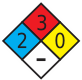
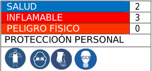
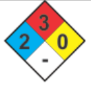
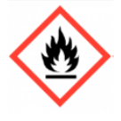
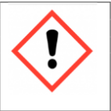
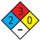

<!-- pagina 1 -->

154

> Texto OCR de la imagen: TECNIS-DECOR

## HOJA DE SEGURIDAD CATALIZADOR DURAGLASS

Página 1 de 5

## 1. IDENTIFICACION DEL FABRICANTE Y DE LA SUBSTANCIA QUIMICA

Empresa:

Nit:

TECNIDECOR S.A.S

900112215-2

Pbx:

444 49 44

Nombre del Producto: CATALIZADOR DURAGLASS

Código del producto:

154

Sinónimos:

N/A

Fórmula:

Poliisocianato alifatico en solución.

Número UN:

1263

Clase UN:

2-3-0

Fecha de actualización: Octubre de 2018

## 2. COMPOSICION, INFORMACION SOBRE INGREDIENTES

&gt;= 70% - &lt; 80% Hexanodiol 1,6 diisocianato oligomero CAS: 28182-81-2, EC: 500-060-2

&gt;= 7% - &lt; 10% xileno REACH No.: 01-2119488216-32-0012, Número Index: 601-022-00-9, CAS: 1330-20-7, EC: 215-535-7

&gt;= 3% - &lt; 5% etilbenceno Número Index: 601-023-00-4, CAS: 100-41-4, EC: 202-849-4

&gt;= 0.25% - &lt; 0.5% 1,6-diisocianato de hexametileno REACH No.: 01-2119457571-37-0001, Número Index: 615-011-00-1,

CAS: 822-06-0, EC: 212-485-8

## 3. IDENTIFICACION DE RIESGOS

Inhalación: La inhalación de concentraciones altas puede causar efectos al sistema nervioso central caracterizados por náuseas, dolor de cabeza, vértigo, inconsciencia y coma. La exposición prolongada puede causar vértigo y debilidad general, y conducir a la neumonitis química y al edema pulmonar. Puede causar daños al hígado y al riñón. Causa irritación a la membrana mucosa. La exposición puede causar anormalidades en la sangre. El olor no es una advertencia adecuada para la sobreexposición al xileno.

Ingestión:. Puede causar irritación de la vía digestiva y efectos similares a de la inhalación aguda.. Puede causar depresión al sistema nervioso central, caracterizado por entusiasmo, seguido por dolor de cabeza, vértigo, somnolencia y náuseas. Las etapas avanzadas pueden causar colapso, inconsciencia, coma y posible muerte debido a un paro respiratorio.

Contacto con la piel: Puede ser absorbido por la piel. El contacto causa desengrase de la piel con dermatitis, irritación, resequedad y cuarteamiento.

Contacto con los ojos: Causa irritación severa de ojos. Los chapoteos de xileno en ojos humanos generalmente causan herida superficial. Se han reportado vacuolas corneales.

> Texto OCR de la imagen: 2 3 0 PROTECCIOON PERSONAL

¡Peligro! Líquido y vapor inflamable. Peligroso si es aspirado. Causa irritación a los ojos. Esta sustancia ha causado efectos adversos reproductivos y fetales en animales. Puede causar depresión del sistema nervioso central. Riesgo de aspiración si es tragado. Puede entrar en pulmones y causar daño.

Puede causar daño en el hígado y el riñón. Puede ser dañino si es absorbido por la piel o si es inhalado.

El contacto prolongado o repetido puede secar la piel y causar irritación.

## 4. PRIMEROS AUXILIOS

## En caso de contacto con la piel:

Quítese inmediatamente la ropa contaminada.

<!-- pagina 2 -->

154

> Texto OCR de la imagen: TECNIS-DECOR

## HOJA DE SEGURIDAD CATALIZADOR DURAGLASS

Página 2 de 5

Lavar inmediatamente con abundante agua corriente y eventualmente jabón las zonas del cuerpo que han entrado en contacto con el producto, incluso si fuera sólo una sospecha.

Lavar completamente el cuerpo (ducha o baño).

Quitarse de inmediato la indumentaria contaminada y eliminarla de manera segura.

## En caso de contacto con los ojos:

Lavar con abundante agua acudir al médico.

## En caso de ingestión:

NO inducir el vómito.

## En caso de inhalación:

En caso de respiración irregular o parada respiratoria, administrar respiración artificial. En caso de inhalación consultar de inmediato con un médico y mostrarle el envase o la etiqueta.

## Principales síntomas y efectos, agudos y retardados:

Ninguno

## Indicación de toda atención médica y de los tratamientos especiales que deban dispensarse inmediatamente:

En caso de accidente o malestar, consultar de inmediato con un médico (si es posible mostrarle las instrucciones de uso o la ficha de seguridad)

## Tratamiento:

Ninguno.

## 5. COMBATE DE INCENDIOS

## Incendio:

Punto de inflamación (ºC): 29 (copa cerrada) Temperatura de autoignición (ºC): 464 Limites de inflamabilidad en el aire % volumen: Lel: 1.1 ; Uel: 7.0. ¡Líquido y vapor extremadamente inflamables!. Los contenedores pueden explotar cuando se calientan. Sus vapores viajan rápidamente hasta la fuente de ignición y pueden retornar envueltos en llamas. Por encima de 43°C forma mezcla explosiva vapor-aire. El contacto con oxidantes fuertes puede producir incendio. Es sensible a descargas estáticas. Medios de extinción adecuados: Polvo químico seco, espuma, dióxido de carbono y agua en forma de neblina. El agua puede ser inefectiva. Este material es insoluble en agua y es más ligero. Productos de la combustión: Gases irritantes, tóxicos y corrosivos. CO2, CO, hidrocarburos y aldehídos. Instrucciones para combatir el fuego: Evacuar o aislar el área de peligro. Restringir el acceso a personas innecesarias y sin la debida protección. Estar a favor del viento. Usar equipo de protección personal. Mantener frescos todos los contenedores que puedan ser afectados con agua en forma de rocío en grandes cantidades y siendo ésta contenida. Aplique el agua desde una distancia tan lejana como sea posible.

Precauciones: Alejar de llamas, fuentes de ignición y calor. Mantener los recipientes bien tapados. Proveer de buena ventilación a nivel del piso. No fumar en los sitios de trabajo. Conectar a tierra los recipientes para evitar descargas electrostáticas. Los equipos eléctricos, de iluminación y ventilación deben ser a prueba de explosiones.

## 6. LIBERACIONES ACCIDENTALES

Evacuar o aislar el área de peligro. Restringir el acceso a personas innecesarias y sin la debida protección. Estar a favor del viento. Usar equipo de protección personal. Ventilar el área. Eliminar toda fuente de ignición. Usar agua en forma de rocío para reducir los vapores, teniendo equipos de contención para retener el agua utilizada. NO permitir que este producto se incorpore al ambiente. Absorber con arena, tierra o vermiculita. Recoger con herramientas que no produzcan chispas y depositar en recipientes con cierre hermético para su posterior disposición.

Lavar y ventilar el área del derrame, una vez recogido el producto.

## 7.MANEJO Y ALMACENAJE

Empaque: El producto puede ser envasado en recipientes metálicos sin recubrimiento interno. Almacenamiento: Lugares ventilados, frescos y secos. Lejos de fuentes de calor e ignición. Separado de materiales incompatibles y oxidantes. Rotular los recipientes adecuadamente y mantenerlos bien cerrados. Lejos de ácidos fuertes.

<!-- pagina 3 -->

154

> Texto OCR de la imagen: TECNIS-DECOR *

## HOJA DE SEGURIDAD CATALIZADOR DURAGLASS

Página 3 de 5

Conectar los recipientes a tierra.

Manejo: Lávese a fondo después del manejo.

Usar siempre protección personal así sea corta la exposición o la actividad que realice con el producto. Evite respirar los vapores y la niebla de este producto. Conocer en dónde está el equipo para la atención de emergencias. Rotular los recipientes adecuadamente. Conectar los recipientes a tierra cuando se realizan transferencias del material para evitar descargas electrostáticas.

## 8. CONTROLES DE EXPOSICION, PROTECCION PERSONAL

Protección de la piel: Usar vestimenta protectora impermeable, incluyendo botas con resistencia a hidrocarburos, guantes

Controles de ingeniería: Ventilación local y general, para asegurar que la concentración no exceda los límites de exposición

Protección respiratoria: Se requiere respirador para vapores orgánicos. de nitrilo, delantal para evitar el contacto directo con la piel. Protección de los ojos: Use monogafas químicas y/o un protector facial completo. ocupacional o se mantenga lo más baja posible. Considerar la posibilidad de encerrar el proceso.

Garantizar el control de las condiciones del proceso. Suministrar aire de reemplazo continuamente para suplir el aire removido. Disponer de duchas y estaciones lavaojos.

## 9. PROPIEDADES FISICAS Y QUIMICAS.

| Propiedad                                     | Valor                  | Método:        | Notas:        |
|-----------------------------------------------|------------------------|----------------|---------------|
| Aspecto:                                      | Líquido                |                |               |
| Color: Olor:                                  | Incoloro o amarillento |                | No disponible |
| Umbral de olor:                               |                        |                | No disponible |
| pH:                                           |                        |                | No disponible |
| Punto de fusión/ congelamiento:               |                        |                | No disponible |
| Punto de ebullición inicial e intervalo       |                        |                |               |
| de ebullición:                                | 145º C                 |                |               |
| Inflamabilidad                                |                        | sólidos/gases: | No disponible |
| Límite superior/                              |                        |                |               |
| inferior de inflamabilidad o explosión:       | 1.5-10.8 %             |                |               |
| Densidad de los vapores:                      |                        |                |               |
|                                               |                        |                | No disponible |
| Punto de ignición (flash point, ):            | 38 ° C                 |                |               |
| Velocidad de evaporación:                     |                        |                | No disponible |
| Presión de vapor:                             | 10hPa                  |                |               |
| Densidad relativa:                            | 1.067 25ºC             |                | No disponible |
| Hidrosolubilidad:                             |                        |                |               |
| Solubilidad en aceite: Coeficiente de reparto | SI                     |                | No disponible |
| (n-octanol/agua):                             | 460ºC                  |                |               |
| Temperatura de autoencendido: Temperatura de  |                        |                |               |
| descomposición:                               |                        |                | No disponible |
| Viscosidad: 250 mPas                          | 23ºC                   |                |               |
| Propiedades explosivas:                       | NO                     |                |               |
| Propiedades comburentes:                      | NO                     |                |               |

## Otros datos

Miscibilidad: No disponible Liposolubilidad: No disponible Conductibilidad: No disponible Propiedades características de los grupos de sustancias: No disponible.

<!-- pagina 4 -->

154

> Texto OCR de la imagen: TECNIS-DECOR *

## HOJA DE SEGURIDAD CATALIZADOR DURAGLASS

Página 4 de 5

## 10. ESTABILIDAD Y REACTIVIDAD

Reactividad

Estabilidad química Estable en condiciones normales Estable en condiciones normales

Sustancias a evitar:

Reacciona lentamente con agua, formando dióxido de carbono (CO2). Puede generar una subida excesiva de presión dentro del recipiente cerrado e incluso llegar a explotar.

Puede generar gases inflamables en contacto con elementos metálicos (alcalinos, alcalinotérreos, aleaciones en polvo o vapor) y agentes reductores fuertes. Puede generar gases tóxicos en contacto con ácidos minerales oxidantes y agentes oxidantes fuertes.

Puede inflamarse en contacto con ácidos minerales oxidantes y agentes oxidantes fuertes

Condiciones que deben evitarse: Estable en condiciones normales.

Materiales incompatibles: Evite el contacto con materias comburentes. El producto podría inflamarse.

Productos de descomposición peligrosos: Ninguno.

## 11. INFORMACION TOXICOLOGICA.

El Xileno es considerado muy tóxico por ingestión, con una dosis estimada oral mortal en los adultos de 50 mg/Kg ó 15 a 30 mL. La exposición por inhalación con una concentración de 1000 ppm es considerada inmediatamente peligrosa para la vida o la salud. Dos muertes han sido reportadas por 12 horas de exposición ó mayor a concentraciones de vapor estimado a 6000 ppm y mayor. LD50 Oral Ratas: 4300 mg/kg LC50 Inhalación Ratas: 5000 ppm/4h Evidencia de daño a los riñones, hígado y pulmones en animales. LD50 Cutáneo Conejos: &gt;1700 mg/kg Irritación Ocular Conejos: 87 mg, Leve Categoría IARC: 3, NO puede ser clasificado como cancerígeno en humanos.

Generador de Efectos Reproductivos. Investigado como Mutagénico, Tumorígeno y Teratogénico.

## 12. INFORMACION ECOLOGICA.

Se espera que este material sea ligeramente tóxico a la vida acuática. En el SUELO, se espera que este material lixivie a aguas subterráneas, que evapore moderadamente, que sea moderadamente biodegradable. En el AGUA, esperan que se evapore y que sea biodegradable. En el AIRE, se espera que sea fácilmente degradado por la reacción con radicales hidroxilos producidos fotoquímicamente, que tenga una vida media menor a 1 día. No se espera que este material sea considerablemente bioacumulable. 96 h LC50 Oncorhynchus mykiss: 10 - 100 mg/L MOVILIDAD: Producto volátil, inflamable, tóxico, insoluble en agua. DEGRADABILIDAD: Producto no biodegradable.

## 13. CONSIDERACIONES SOBRE LA DISPOSICION.

Incinerar en forma adecuada los materiales empleados en la absorción del derrame. necesario dictar normas especiales complementarias para la cumplida ejecución de las leyes que regulan los residuos sólidos

Los residuos de esta sustancia están considerados en: Ministerio de Salud. Resolución 2309 de 1986, por la cual se hace y concretamente lo referente a residuos especiales.

## 14. INFORMACION SOBRE EL TRANSPORTE.

No transporte con sustancias explosivas, venenosas, sólidos de combustión espontánea, agentes comburentes, peróxidos orgánicos, materiales radiactivos, sustancias incompatibles ni sustancias con riesgo de incendio.

## Clase IMO: 3,

<!-- pagina 5 -->

> Texto OCR de la imagen: TECNIS-DECOR

## HOJA DE SEGURIDAD CATALIZADOR DURAGLASS

Página 5 de 5

Líquido Inflamable

U.N.: 1263

Grupo de embalaje: III

## 15. INFORMACION SOBRE REGLAMENTACION.

Algunos de sus componentes están regulados para el transporte, se debe dar cumplimiento al Decreto 1609 de 2002. Ministerio de Transporte.

NOTA: La información proporcionada cubre lo descrito en la hoja de seguridad. Se requiere la atención del usuario hacia la existencia de disposiciones complementarias. Consultar las regulaciones nacionales, internacionales y locales aplicables.

## 16. OTRA INFORMACION.

Esta hoja de seguridad tiene como fin sólo a brindar una guía basada en la Norma NTC 4435. Para el manejo del material con la precaución apropiada Las personas que reciban la información deben ejercer su propio criterio para determinar la conveniencia del uso de este producto para un fin específico. TECNIDECOR S.A.S no se hace responsable de ningún daño causado a propiedades o a personas por el uso inadecuado de nuestros productos, ya que no conocemos la manipulación ni las precauciones que cada cliente tiene en el almacenamiento.
