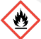
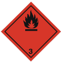
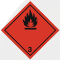
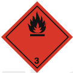

<!-- pagina 1 -->

## Ficha de datos de seguridad

## PINTURA EPOXI POLIAMIDA BLANCO 13243

## 10012925-10344427

## SECCIÓN 1: IDENTIFICACIÓN DEL PRODUCTO

1.1 Identificador SGA del producto: PINTURA EPOXI POLIAMIDA BLANCO 13243

10012925-10344427

## 1.2 Uso recomendado del producto químico y restricciones:

Usos pertinentes: Pintura. Uso exclusivo usuario profesional.

Usos desaconsejados: Todo aquel uso no especificado en este epígrafe ni en el epígrafe 7.3

## 1.3 Datos sobre el proveedor:

Pintuco

Autopista Medellín Bogotá Km 37 Vía Belén Rionegro Km 1

054040 Rionegro - Antioquia - Colombia Tfno.: 57 4 569 81 00 contacto@pintuco.com http://www.pintuco.com

- 1.4 Número de teléfono para emergencias: 57 4 561 22 23

## SECCIÓN 2: IDENTIFICACIÓN DEL PELIGRO O PELIGROS

## 2.1 Clasificación de la sustancia o de la mezcla:

## SGA:

La clasificación del producto se ha realizado conforme con al decreto 1496 de 2018, por el cual se adopta el Sistema Globalmente Armonizado de Clasificación y Etiquetado de Productos Químicos y se dictan otras disposiciones en materia de seguridad química.

Irrit. Cut. 2: Irritación cutánea, categoría 2, H315 Les. Oc. 1: Lesiones oculares graves, Categoría 1, H318 Liq. Infl. 3: Líquidos inflamables, Categoría 3, H226 Sens. Cut. 1: Sensibilización cutánea, Categoría 1, H317 Tox. Agud. 4: Toxicidad aguda por contacto con la piel, Categoría 4, H312 Tox. Agud. 4: Toxicidad aguda por inhalación, Categoría 4, H332 Tox. Agud. 5: Toxicidad aguda por ingestión, Categoría 5, H303

## 2.2 Elementos de las etiquetas del SGA, incluidos los consejos de prudencia:

## SGA:

Peligro

## Indicaciones de peligro:

Sens. Cut. 1: H317 - Puede provocar una reacción cutánea alérgica

Irrit. Cut. 2: H315 - Provoca irritación cutánea Les. Oc. 1: H318 - Provoca lesiones oculares graves Liq. Infl. 3: H226 - Líquido y vapores inflamables Tox. Agud. 4: H312 - Nocivo en contacto con la piel Tox. Agud. 4: H332 - Nocivo si se inhala

Tox. Agud. 5: H303 - Puede ser nocivo en caso de ingestión

> Texto OCR de la imagen: Calidad"

## Consejos de prudencia:

P210: Mantener alejado del calor, superficies calientes, chispas llamas al descubierto y otras fuentes de ignición. No fumar P280: Usar guantes/ropa de protección/equipo de protección para los ojos/la cara

P302+P352: EN CASO DE CONTACTO CON LA PIEL: Lavar con abundante agua

P304+P340: EN CASO DE INHALACIÓN: Transportar a la persona al aire libre y mantenerla en una posición que le facilite la respiración

P305+P351+P338: EN CASO DE CONTACTO CON LOS OJOS: Enjuagar con agua cuidadosamente durante varios minutos. Quitar las lentes de contacto cuando estén presentes y pueda hacerse con facilidad. Proseguir con el lavado

P308+P313: EN CASO DE exposición demostrada o supuesta: consultar a un médico

P370+P378: En caso de incendio: Utilizar extintor de polvo ABC para la extinción

P501: Eliminar el contenido/recipiente de acuerdo con la normativa sobre residuos peligrosos o envases y residuos de envases respectivamente

## Sustancias que contribuyen a la clasificación

Copolimero epoxy epicloridrina/Bisfenol A (700 &lt; MW &lt; 1100)

<!-- pagina 2 -->

## Ficha de datos de seguridad

según Decreto 1496 de 2018

## PINTURA EPOXI POLIAMIDA BLANCO 13243

## 10012925-10344427

## SECCIÓN 2: IDENTIFICACIÓN DEL PELIGRO O PELIGROS (continúa)

## 2.3 Otros peligros que no conducen a una clasificación:

No relevante

## SECCIÓN 3: COMPOSICIÓN/INFORMACIÓN SOBRE LOS COMPONENTES

## 3.1 Sustancias:

No aplicable

## 3.2 Mezclas:

Descripción química: Mezcla a base de productos químicos

## Componentes:

De acuerdo al Decreto 1496 de 2018, el producto presenta:

| Identificación   | Identificación   | Nombre químico/clasificación                                | Concentración   |
|------------------|------------------|-------------------------------------------------------------|-----------------|
| CAS:             | 25036-25-3       | Copolimero epoxy epicloridrina/Bisfenol A (700 < MW < 1100) | 10 - <25 %      |
| CAS:             | 13463-67-7       | Dioxido de titanio                                          | 2.5 - <10 %     |
| CAS:             | 1330-20-7        | Xileno                                                      | 2.5 - <10 %     |
| CAS:             | 111-76-2         | 2-butoxietanol                                              | 2.5 - <10 %     |
| CAS:             | 108-38-3         | m-xileno                                                    | 2.5 - <10 %     |
| CAS:             | 78-83-1          | 2-metilpropan-1-ol                                          | 2.5 - <10 %     |
| CAS:             | 106-42-3         | p-xileno                                                    | 1 - <2.5 %      |
| CAS:             | 95-47-6          | o-xileno                                                    | 1 - <2.5 %      |
| CAS:             | 100-41-4         | Etilbenceno                                                 | <1 %            |

Para ampliar información sobre la peligrosidad de la sustancias consultar las secciones 8, 11, 12, 15 y 16. La clasificación respecto Carcinogenicidad de las sustancias se ha establecido en función de las monografías de la IARC adecuandola al sistema de clasificación SGA, para información sobre la clasificación IARC consulte la sección 11.

## SECCIÓN 4: PRIMEROS AUXILIOS

## 4.1 Descripción de los primeros auxilios necesarios:

Los síntomas como consecuencia de una intoxicación pueden presentarse con posterioridad a la exposición, por lo que, en caso de duda, exposición directa al producto químico o persistencia del malestar solicitar atención médica, mostrándole la FDS de este producto.

## Por inhalación:

Sacar al afectado del lugar de exposición, suministrarle aire limpio y mantenerlo en reposo. En casos graves como parada cardiorespiratoria, se aplicarán técnicas de respiración artificial (respiración boca a boca, masaje cardíaco, suministro de oxígeno,etc.) requiriendo asistencia médica inmediata.

## Por contacto con la piel:

Quitar la ropa y los zapatos contaminados, aclarar la piel o duchar al afectado si procede con abundante agua fría y jabón neutro. En caso de afección importante acudir al médico. Si el producto produce quemaduras o congelación, no se debe quitar la ropa debido a que podría empeorar la lesión producida si esta se encuentra pegada a la piel. En el caso de formarse ampollas en la piel, éstas nunca deben reventarse ya que aumentaría el riesgo de infección.

## Por contacto con los ojos:

Enjuagar los ojos con abundante agua a temperatura ambiente al menos durante 15 minutos. Evitar que el afectado se frote o cierre los ojos. En el caso de que el accidentado use lentes de contacto, éstas deben retirarse siempre que no estén pegadas a los ojos, de otro modo podría producirse un daño adicional. En todos los casos, después del lavado, se debe acudir al médico lo más rápidamente posible con la FDS del producto.

<!-- pagina 3 -->

## Ficha de datos de seguridad

## PINTURA EPOXI POLIAMIDA BLANCO 13243

## 10012925-10344427

## SECCIÓN 4: PRIMEROS AUXILIOS (continúa)

## Por ingestión/aspiración:

No inducir al vómito, en el caso de que se produzca mantener inclinada la cabeza hacia delante para evitar la aspiración. Mantener al afectado en reposo. Enjuagar la boca y la garganta, ya que existe la posibilidad de que hayan sido afectadas en la ingestión.

## 4.2 Síntomas/efectos más importantes, agudos o retardados:

Los efectos agudos y retardados son los indicados en las secciones 2 y 11.

## 4.3 Indicación de la necesidad de recibir atención médica inmediata y, en su caso, de tratamiento especial:

No relevante

## SECCIÓN 5: MEDIDAS DE LUCHA CONTRA INCENDIOS

## 5.1 Medios de extinción apropiados:

Emplear preferentemente extintores de polvo polivalente (polvo ABC), alternativamente utilizar espuma física o extintores de dióxido de carbono (CO2). NO SE RECOMIENDA emplear agua a chorro como agente de extinción.

## 5.2 Peligros específicos del producto químico:

Como consecuencia de la combustión o descomposición térmica se generan subproductos de reacción que pueden resultar altamente tóxicos y, consecuentemente, pueden presentar un riesgo elevado para la salud.

## 5.3 Medidas especiales que deben tomar los equipos de lucha contra incendios:

En función de la magnitud del incendio puede hacerse necesario el uso de ropa protectora completa y equipo de respiración autónomo. Disponer de un mínimo de instalaciones de emergencia o elementos de actuación (mantas ignífugas, botiquín portátil,...).

## Disposiciones adicionales:

Actuar conforme el Plan de Emergencia Interior y las Fichas Informativas sobre actuación ante accidentes y otras emergencias. Suprimir cualquier fuente de ignición. En caso de incendio, refrigerar los recipientes y tanques de almacenamiento de productos susceptibles a inflamación, explosión como consecuencia de elevadas temperaturas. Evitar el vertido de los productos empleados en la extinción del incendio al medio acuático.

## SECCIÓN 6: MEDIDAS QUE DEBEN TOMARSE EN CASO DE VERTIDO ACCIDENTAL

## 6.1 Precauciones personales, equipo protector y procedimiento de emergencia:

Aislar las fugas siempre y cuando no suponga un riesgo adicional para las personas que desempeñen esta función. Evacuar la zona y mantener a las personas sin protección alejadas. Ante el contacto potencial con el producto derramado se hace obligatorio el uso de elementos de protección personal (ver sección 8). Evitar de manera prioritaria la formación de mezclas vapor-aire inflamables, ya sea mediante ventilación o el uso de un agente inertizante. Suprimir cualquier fuente de ignición. Eliminar las cargas electroestáticas mediante la interconexión de todas las superficies conductoras sobre las que se puede formar electricidad estática, y estando a su vez el conjunto conectado a tierra.

## 6.2 Precauciones relativas al medio ambiente:

Producto no clasificado como peligroso para el medioambiente. Mantener el producto alejado de los desagües y de las aguas superficiales y subterráneas.

## 6.3 Métodos y materiales para la contención y limpieza de vertidos:

Se recomienda:

Absorber el vertido mediante arena o absorbente inerte y trasladarlo a un lugar seguro. No absorber en serrín u otros absorbentes combustibles. Para cualquier consideración relativa a la eliminación consultar la sección 13.

## 6.4 Referencias a otras secciones:

Ver secciones 8 y 13.

## SECCIÓN 7: MANIPULACIÓN Y ALMACENAMIENTO

## 7.1 Precauciones que se deben tomar para garantizar una manipulación segura:

## A.- Precauciones generales

Cumplir con la legislación vigente en materia de prevención de riesgos laborales. Mantener los recipientes herméticamente cerrados. Controlar los derrames y residuos, eliminándolos con métodos seguros (sección 6). Evitar el vertido libre desde el recipiente. Mantener orden y limpieza donde se manipulen productos peligrosos.

- B.- Recomendaciones técnicas para la prevención de incendios y explosiones.

<!-- pagina 4 -->

## Ficha de datos de seguridad

## PINTURA EPOXI POLIAMIDA BLANCO 13243

## 10012925-10344427

## SECCIÓN 7: MANIPULACIÓN Y ALMACENAMIENTO (continúa)

Trasvasar en lugares bien ventilados, preferentemente mediante extracción localizada. Controlar totalmente los focos de ignición (teléfonos móviles, chispas,…) y ventilar en las operaciones de limpieza. Evitar la existencia de atmósferas peligrosas en el interior de recipientes, aplicando en lo posible sistemas de inertización. Trasvasar a velocidades lentas para evitar la generación de cargas electroestáticas. Ante la posibilidad de existencia de cargas electroestáticas: asegurar una perfecta conexión equipotencial, utilizar siempre tomas de tierras, no emplear ropa de trabajo de fibras acrílicas, empleando preferiblemente ropa de algodón y calzado conductor. Cumplir con los requisitos esenciales de seguridad para equipos y con las disposiciones mínimas para la protección de la seguridad y salud de los trabajadores. Consultar la sección 10 sobre condiciones y materias que deben evitarse.

- C.- Recomendaciones técnicas para prevenir riesgos ergonómicos y toxicológicos.

Para control de exposición consultar la sección 8. No comer, beber ni fumar en las zonas de trabajo; lavarse las manos después de cada utilización, y despojarse de prendas de vestir y equipos de protección contaminados antes de entrar en las zonas para comer.

- D.- Recomendaciones técnicas para prevenir riesgos medioambientales

Se recomienda disponer de material absorbente en las proximidades del producto (ver epígrafe 6.3)

## 7.2 Condiciones de almacenamiento seguro, incluidas cualesquiera incompatibilidades:

- A.- Medidas técnicas de almacenamiento
- B.- Condiciones generales de almacenamiento.

Tª mínima:

Tª máxima:

5 ºC

30 ºC

Tiempo máximo:

18 meses

Evitar fuentes de calor, radiación, electricidad estática y el contacto con alimentos. Para información adicional ver epígrafe 10.5

## 7.3 Usos específicos finales:

Salvo las indicaciones ya especificadas no es preciso realizar ninguna recomendación especial en cuanto a los usos de este producto.

## SECCIÓN 8: CONTROLES DE EXPOSICIÓN/PROTECCIÓN PERSONAL

## 8.1 Parámetros de control:

Sustancias cuyos valores límite de exposición profesional han de controlarse en el ambiente de trabajo (ACGIH):

| Identificación - Dioxido de titanio - CAS: 13463-67-7   | Valores límite ambientales - TLV-TWA - TLV-STEL   | Valores límite ambientales   | Valores límite ambientales - 10 mg/m³   |
|---------------------------------------------------------|---------------------------------------------------|------------------------------|-----------------------------------------|
| Xileno CAS: 1330-20-7                                   | TLV-STEL                                          | 100 ppm 150 ppm              |                                         |
|                                                         | TLV-TWA                                           |                              |                                         |
| 2-butoxietanol                                          | TLV-TWA                                           | 20 ppm                       |                                         |
| CAS: 111-76-2                                           | TLV-STEL                                          |                              |                                         |
| 2-metilpropan-1-ol                                      | TLV-TWA                                           | 50 ppm                       |                                         |
| CAS: 78-83-1 Etilbenceno                                | TLV-STEL                                          |                              |                                         |
| CAS:                                                    |                                                   |                              |                                         |
|                                                         |                                                   | 20 ppm                       |                                         |
|                                                         | TLV-STEL                                          |                              |                                         |
| 100-41-4                                                |                                                   |                              |                                         |
|                                                         | TLV-TWA                                           |                              |                                         |

## 8.2 Controles técnicos apropiados:

- A.- Medidas de protección individual, como equipo de protección personal (EPP)

Como medida de prevención se recomienda la utilización de equipos de protección individual básicos. Para más información sobre los equipos de protección individual (almacenamiento, uso, limpieza, mantenimiento, clase de protección,…) consultar el folleto informativo facilitado por el fabricante del EPP. Las indicaciones contenidas en este punto se refieren al producto puro. Las medidas de protección para el producto diluido podrán variar en función de su grado de dilución, uso, método de aplicación, etc. Para determinar la obligación de instalación de duchas de emergencia y/o lavaojos en los almacenes se tendrá en cuenta la normativa referente al almacenamiento de productos químicos aplicable en cada caso. Para más información ver epígrafes 7.1 y 7.2.

Toda la información aquí incluida es una recomendación siendo necesario su concreción por parte de los servicios de prevención de riesgos laborales al desconocer las medidas de prevención adicionales que la empresa pudiese disponer.

- B.- Protección respiratoria.

<!-- pagina 5 -->

## PINTURA EPOXI POLIAMIDA BLANCO 13243

## 10012925-10344427

## SECCIÓN 8: CONTROLES DE EXPOSICIÓN/PROTECCIÓN PERSONAL (continúa)

| Pictograma                                        | EPP                                      | Observaciones                                                                                                                                                                                                      |
|---------------------------------------------------|------------------------------------------|--------------------------------------------------------------------------------------------------------------------------------------------------------------------------------------------------------------------|
| Proteccion obligatoria del las vias respiratorias | Máscara con filtros para gases y vapores | Reemplazar cuando se detecte olor o sabor del contaminante en el interior de la máscara o adaptador facial. Cuando el contaminante no tiene buenas propiedades de aviso se recomienda el uso de equipos aislantes. |

## C.- Protección específica de las manos.

> Texto OCR de la imagen: Proteccion obligatoria de la ‘manos

| Pictograma                         | EPP                           | Observaciones                                                                                                                                                                                       |
|------------------------------------|-------------------------------|-----------------------------------------------------------------------------------------------------------------------------------------------------------------------------------------------------|
| Proteccion obligatoria de la manos | Guantes de protección química | El tiempo de paso (Breakthrough Time) indicado por el fabricante ha de ser superior al del tiempo de uso del producto. No emplear cremas protectoras despues del contacto del producto con la piel. |

Dado que el producto es una mezcla de diferentes materiales, la resistencia del material de los guantes no se puede calcular de antemano con total fiabilidad y por lo tanto tiene que ser controlados antes de su aplicación.

## D.- Protección ocular y facial

| Pictograma                        | EPP                | Observaciones                                                                                                                                        |
|-----------------------------------|--------------------|------------------------------------------------------------------------------------------------------------------------------------------------------|
| Proteccion obligatoria de la cara | Gafas de seguridad | Limpiar a diario y desinfectar periódicamente de acuerdo a las instrucciones del fabricante. Se recomienda su uso en caso de riesgo de salpicaduras. |

## E.- Protección corporal

| Pictograma                                                                                                                                                                        | EPP                                                                                              | Observaciones                                                                                      |
|-----------------------------------------------------------------------------------------------------------------------------------------------------------------------------------|--------------------------------------------------------------------------------------------------|----------------------------------------------------------------------------------------------------|
| Proteccion obligatoria del cuerpo Proteccion obligatoria de pies  

> Texto OCR de la imagen: Proteccion obligatoria de los pies | Prenda de protección frente a riesgos químicos, antiestática e ignífuga                          | Uso exclusivo en el trabajo. Limpiar periódicamente de acuerdo a las instrucciones del fabricante. |
| los                                                                                                                                                                               | Calzado de seguridad contra riesgo químico, con propiedades antiestáticas y resistencia al calor | Reemplazar las botas ante cualquier indicio de deterioro.                                          |

## F.- Medidas complementarias de emergencia

| Medida de emergencia   | Normas                      | Medida de emergencia   | Normas                     |
|------------------------|-----------------------------|------------------------|----------------------------|
| Ducha de emergencia    | ANSI Z358-1 ISO 3864-1:2002 | Lavaojos               | DIN 12 899 ISO 3864-1:2002 |

## Controles de la exposición del medio ambiente:

En virtud de la legislación comunitaria de protección del medio ambiente se recomienda evitar el vertido tanto del producto como de su envase al medio ambiente. Para información adicional ver epígrafe 7.1.D

## SECCIÓN 9: PROPIEDADES FÍSICAS Y QUÍMICAS Y CARACTERÍSTICAS DE SEGURIDAD

## 9.1 Información de propiedades físicas y químicas básicas:

Para completar la información ver la ficha técnica/hoja de especificaciones del producto.

## Aspecto físico:

Estado físico a 20 ºC:

Aspecto:

Líquido

Característico

Color:

Característico

*No relevante debido a la naturaleza del producto, no aportando información característica de su peligrosidad.

<!-- pagina 6 -->

> Texto OCR de la imagen: El Color de la Ae

## PINTURA EPOXI POLIAMIDA BLANCO 13243

## SECCIÓN 9: PROPIEDADES FÍSICAS Y QUÍMICAS Y CARACTERÍSTICAS DE SEGURIDAD (continúa)

Olor: Característico Umbral olfativo: No relevante *

## Volatilidad:

Temperatura de ebullición a presión atmosférica: 135 ºC Presión de vapor a 20 ºC: 1271 Pa Presión de vapor a 50 ºC: 51,46 (6,86 kPa) Tasa de evaporación a 20 ºC: No relevante *

## Caracterización del producto:

Densidad a 20 ºC:

1372 kg/m³

Densidad relativa a 20 ºC:

1,421 - 1,448

Viscosidad dinámica a 20 ºC:

No relevante *

Viscosidad cinemática a 20 ºC:

No relevante *

Viscosidad cinemática a 40 ºC:

No relevante *

Concentración:

No relevante *

pH:

No relevante *

Densidad de vapor a 20 ºC:

No relevante *

Coeficiente de reparto n-octanol/agua a 20 ºC:

No relevante *

Solubilidad en agua a 20 ºC:

No relevante *

Propiedad de solubilidad:

No relevante *

Temperatura de descomposición:

No relevante *

Punto de fusión/punto de congelación:

No relevante *

Propiedades explosivas:

No relevante *

Propiedades comburentes:

No relevante *

## Inflamabilidad:

Punto de inflamación: 50 ºC Inflamabilidad (sólido, gas): No relevante * Temperatura de auto-inflamación: 238 ºC Límite de inflamabilidad inferior: No determinado Límite de inflamabilidad superior: No determinado

## Explosividad:

Límite inferior de explosividad: No relevante * Límite superior de explosividad: No relevante *

## 9.2 Información adicional:

Tensión superficial a 20 ºC:

No relevante *

Índice de refracción:

No relevante *

*No relevante debido a la naturaleza del producto, no aportando información característica de su peligrosidad.

## SECCIÓN 10: ESTABILIDAD Y REACTIVIDAD

## 10.1 Reactividad:

No se esperan reacciones peligrosas si se cumplen las instrucciones técnicas de almacenamiento de productos químicos. Ver sección 7.

## 10.2 Estabilidad química:

Estable químicamente bajo las condiciones indicadas de almacenamiento, manipulación y uso.

## 10.3 Posibilidad de reacciones peligrosas:

Bajo las condiciones indicadas no se esperan reacciones peligrosas que puedan producir una presión o temperaturas excesivas.

## 10.4 Condiciones que deben evitarse:

<!-- pagina 7 -->

## Ficha de datos de seguridad

## PINTURA EPOXI POLIAMIDA BLANCO 13243

## 10012925-10344427

## SECCIÓN 10: ESTABILIDAD Y REACTIVIDAD (continúa)

Aplicables para manipulación y almacenamiento a temperatura ambiente:

| Choque y fricción   | Contacto con el aire   | Calentamiento         | Luz Solar                 | Humedad      |
|---------------------|------------------------|-----------------------|---------------------------|--------------|
| No aplicable        | No aplicable           | Riesgo de inflamación | Evitar incidencia directa | No aplicable |

## 10.5 Materiales incompatibles:

| Ácidos                | Agua         | Materias comburentes      | Materias combustibles   | Otros                          |
|-----------------------|--------------|---------------------------|-------------------------|--------------------------------|
| Evitar ácidos fuertes | No aplicable | Evitar incidencia directa | No aplicable            | Evitar alcalis o bases fuertes |

## 10.6 Productos de descomposición peligrosos:

Ver epígrafe 10.3, 10.4 y 10.5 para conocer los productos de descomposición específicamente. En dependencia de las condiciones de descomposición, como consecuencia de la misma pueden liberarse mezclas complejas de sustancias químicas: dióxido de carbono (CO2), monóxido de carbono y otros compuestos orgánicos.

## SECCIÓN 11: INFORMACIÓN TOXICOLÓGICA

## 11.1 Información sobre las posibles vías de exposición:

No se dispone de datos experimentales del producto en si mismos relativos a las propiedades toxicológicas

Contiene glicoles, posibilidad de efectos peligrosos para la salud, por lo que se recomienda no respirar sus vapores prolongadamente

## Efectos peligrosos para la salud:

En caso de exposición repetitiva, prolongada o a concentraciones superiores a las establecidas por los límites de exposición profesionales, pueden producirse efectos adversos para la salud en función de la vía de exposición:

- A- Ingestión (efecto agudo):
- Toxicidad aguda: La ingesta de una dosis considerable puede originar irritación de garganta, dolor abdominal, náuseas y vómitos.
- Corrosividad/Irritabilidad: La ingesta de una dosis considerable puede originar irritación de garganta, dolor abdominal, náuseas y vómitos.
- B- Inhalación (efecto agudo):
- Toxicidad aguda: Una exposición a altas concentraciones pueden motivar depresión del sistema nervioso central ocasionando dolor de cabeza, mareos, vértigos, nauseas, vómitos, confusión y en caso de afección grave, pérdida de conciencia.
- Corrosividad/Irritabilidad: A la vista de los datos disponibles, no se cumplen los criterios de clasificación. Para más información ver sección 3.

## C- Contacto con la piel y los ojos (efecto agudo):

- Contacto con la piel: Produce inflamación cutánea.
- Contacto con los ojos: Produce lesiones oculares importantes tras contacto.
- D- Efectos CMR (carcinogenicidad, mutagenicidad y toxicidad para la reproducción):
- Carcinogenicidad: No se cumplen criterios de clasificación. Para más información sobre posibles efectos específicos sobre la salud ver sección 2.
- IARC: Xileno (3); Etilbenceno (2B); Dioxido de titanio (2B); 2-butoxietanol (3)
- Mutagenicidad: A la vista de los datos disponibles, no se cumplen los criterios de clasificación, no presentando sustancias clasificadas como peligrosas por este efecto. Para más información ver sección 3.
- Toxicidad para la reproducción: A la vista de los datos disponibles, no se cumplen los criterios de clasificación, no presentando sustancias clasificadas como peligrosas por este efecto. Para más información ver sección 3.
- E- Efectos de sensibilización:
- Respiratoria: A la vista de los datos disponibles, no se cumplen los criterios de clasificación, no presentando sustancias clasificadas como peligrosas con efectos sensibilizantes. Para más información ver secciónes 2, 3 y 15.
- Cutánea: El contacto prolongado con la piel puede derivar en EPPsodios de dermatitis alérgicas de contacto.
- F- Toxicidad específica en determinados órganos (STOT)-exposición única:

A la vista de los datos disponibles, no se cumplen los criterios de clasificación. Para más información ver sección 3.

- G- Toxicidad específica en determinados órganos (STOT)-exposición repetida:

<!-- pagina 8 -->

> Texto OCR de la imagen: El Color de la Ae

## Ficha de datos de seguridad

según Decreto 1496 de 2018

## PINTURA EPOXI POLIAMIDA BLANCO 13243

## 10012925-10344427

## SECCIÓN 11: INFORMACIÓN TOXICOLÓGICA (continúa)

- Toxicidad específica en determinados órganos (STOT)-exposición repetida: A la vista de los datos disponibles, no se cumplen los criterios de clasificación, no presentando sustancias clasificadas como peligrosas por este efecto. Para más información ver sección 3.
- Piel: A la vista de los datos disponibles, no se cumplen los criterios de clasificación, no presentando sustancias clasificadas como peligrosas por este efecto. Para más información ver sección 3.
- H- Peligro por aspiración:

A la vista de los datos disponibles, no se cumplen los criterios de clasificación, no presentando sustancias clasificadas como peligrosas por este efecto. Para más información ver sección 3.

## Información adicional:

CAS 13463-67-7 Dióxido de Titanio: IARC lista esta sustancia como un posible carcinógeno humano (grupo 2B), indicando que hay suficientes evidencias para considerarlo carcinógeno en animales pero insuficientes para considerarlo como carcinógeno para seres humanos.

La monografía de IARC para esta sustancia indica que no hay exposición significativa al dióxido de titanio durante el uso normal de productos en los que dióxido de titanio está unido permanentemente a otros materiales, tales como pinturas (Ref: Monografía IARC, Vol. 93, 2010).

El lijado repetido de las superficies de película seca puede producir riesgo de sobreexposición al polvo dependiendo de la duración y nivel de lijado, para evitarla deben tomarse las medidas de protección adecuadas.

## Información toxicológica específica de las sustancias:

| Identificación     | Toxicidad aguda   | Toxicidad aguda      | Género   |
|--------------------|-------------------|----------------------|----------|
| Xileno             | DL50 oral         | 2100 mg/kg           | Rata     |
| CAS: 1330-20-7     | DL50 cutánea      | 1100 mg/kg (ATEi)    | Rata     |
|                    | CL50 inhalación   | 11 mg/L (4 h) (ATEi) |          |
| 2-metilpropan-1-ol | DL50 oral         | 3350 mg/kg           | Rata     |
| CAS: 78-83-1       | DL50 cutánea      | 2460 mg/kg           | Conejo   |
|                    | CL50 inhalación   | 24,6 mg/L (4 h)      | Rata     |
| p-xileno           | DL50 oral         | 1590 mg/kg           | Ratón    |
| CAS: 106-42-3      | DL50 cutánea      | 1100 mg/kg (ATEi)    |          |
|                    | CL50 inhalación   | 11 mg/L (4 h) (ATEi) |          |
| m-xileno           | DL50 oral         | 1590 mg/kg           | Ratón    |
| CAS: 108-38-3      | DL50 cutánea      | 1100 mg/kg (ATEi)    |          |
|                    | CL50 inhalación   | 11 mg/L (4 h) (ATEi) |          |
| o-xileno           | DL50 oral         | 1590 mg/kg           | Ratón    |
| CAS: 95-47-6       | DL50 cutánea      | 1100 mg/kg (ATEi)    |          |
|                    | CL50 inhalación   | 11 mg/L (4 h) (ATEi) |          |
| Dioxido de titanio | DL50 oral         | 10000 mg/kg          | Rata     |
| CAS: 13463-67-7    | DL50 cutánea      | 10000 mg/kg          | Conejo   |
|                    | CL50 inhalación   | No relevante         |          |
| 2-butoxietanol     | DL50 oral         | 1414 mg/kg           | Rata     |
| CAS: 111-76-2      | DL50 cutánea      | 1060 mg/kg           | Conejo   |
|                    | CL50 inhalación   | 11 mg/L (4 h)        | Rata     |
| Etilbenceno        | DL50 oral         | 3500 mg/kg           | Rata     |
| CAS: 100-41-4      | DL50 cutánea      | 15354 mg/kg          | Conejo   |
|                    | CL50 inhalación   | 17,2 mg/L (4 h)      | Rata     |

## SECCIÓN 12: INFORMACIÓN ECOTOXICOLÓGICA

No se disponen de datos experimentales de la mezcla en sí misma relativos a las propiedades ecotoxicológicas.

## 12.1 Toxicidad:

| Identificación   | Toxicidad aguda   | Toxicidad aguda   | Especie                         | Género    |
|------------------|-------------------|-------------------|---------------------------------|-----------|
| Xileno           | CL50              | 13,5 mg/L (96 h)  | Oncorhynchus mykiss             | Pez       |
| CAS: 1330-20-7   | CE50              | 3,4 mg/L (48 h)   | Ceriodaphnia dubia              | Crustáceo |
|                  | CE50              | 10 mg/L (72 h)    | Skeletonema costatum            | Alga      |
| 2-butoxietanol   | CL50              | 1490 mg/L (96 h)  | Lepomis macrochirus             | Pez       |
| CAS: 111-76-2    | CE50              | 1815 mg/L (48 h)  | Daphnia magna                   | Crustáceo |
|                  | CE50              | 911 mg/L (72 h)   | Pseudokirchneriella subcapitata | Alga      |

<!-- pagina 9 -->

> Texto OCR de la imagen: El Color de la Ae

## PINTURA EPOXI POLIAMIDA BLANCO 13243

## SECCIÓN 12: INFORMACIÓN ECOTOXICOLÓGICA (continúa)

| Identificación     | Toxicidad aguda   | Toxicidad aguda   | Especie                 | Género    |
|--------------------|-------------------|-------------------|-------------------------|-----------|
| m-xileno           | CL50              | 16 mg/L (96 h)    | Carassius auratus       | Pez       |
| CAS: 108-38-3      | CE50              | 9,56 mg/L (48 h)  | Daphnia magna           | Crustáceo |
| CAS: 108-38-3      | CE50              | No relevante      |                         |           |
| 2-metilpropan-1-ol | CL50              | 2030 mg/L (96 h)  | Carassius auratus       | Pez       |
| CAS: 78-83-1       | CE50              | 1439 mg/L (48 h)  | Daphnia magna           | Crustáceo |
| CAS: 78-83-1       | CE50              | 1250 mg/L (48 h)  | Scenedesmus subspicatus | Alga      |
| p-xileno           | CL50              | 2,6 mg/L (96 h)   | Oncorhynchus mykiss     | Pez       |
| CAS: 106-42-3      | CE50              | 8,5 mg/L (48 h)   | Daphnia magna           | Crustáceo |
| CAS: 106-42-3      | CE50              | No relevante      |                         |           |
| o-xileno           | CL50              | 16,1 mg/L (96 h)  | Lepomis macrochirus     | Pez       |
| CAS: 95-47-6       | CE50              | 1,39 mg/L (48 h)  | Daphnia magna           | Crustáceo |
| CAS: 95-47-6       | CE50              | No relevante      |                         |           |
| Etilbenceno        | CL50              | 42,3 mg/L (96 h)  | Pimephales promelas     | Pez       |
| CAS: 100-41-4      | CE50              | 75 mg/L (48 h)    | Daphnia magna           | Crustáceo |
| CAS: 100-41-4      | CE50              | 63 mg/L (3 h)     | Chlorella vulgaris      | Alga      |

## 12.2 Persistencia y degradabilidad:

| Identificación                  | Degradabilidad   | Degradabilidad   | Biodegradabilidad   | Biodegradabilidad   |
|---------------------------------|------------------|------------------|---------------------|---------------------|
| Xileno CAS: 1330-20-7           | DBO5             | No relevante     | Concentración       | No relevante        |
| Xileno CAS: 1330-20-7           | DQO              | No relevante     | Periodo             | 28 días             |
| Xileno CAS: 1330-20-7           | DBO5/DQO         | No relevante     | % Biodegradado      | 88 %                |
| 2-butoxietanol CAS: 111-76-2    | DBO5             | 0.71 g O2/g      | Concentración       | 100 mg/L            |
| 2-butoxietanol CAS: 111-76-2    | DQO              | 2.2 g O2/g       | Periodo             | 14 días             |
| 2-butoxietanol CAS: 111-76-2    | DBO5/DQO         | 0.32             | % Biodegradado      | 96 %                |
| 2-metilpropan-1-ol CAS: 78-83-1 | DBO5             | 0.4 g O2/g       | Concentración       | 100 mg/L            |
| 2-metilpropan-1-ol CAS: 78-83-1 | DQO              | 2.41 g O2/g      | Periodo             | 14 días             |
| 2-metilpropan-1-ol CAS: 78-83-1 | DBO5/DQO         | 0.17             | % Biodegradado      | 90 %                |
| p-xileno CAS: 106-42-3          | DBO5             | No relevante     | Concentración       | No relevante        |
| p-xileno CAS: 106-42-3          | DQO              | No relevante     | Periodo             | No relevante        |
| p-xileno CAS: 106-42-3          | DBO5/DQO         | 0.92             | % Biodegradado      | No relevante        |
| o-xileno CAS: 95-47-6           | DBO5             | No relevante     | Concentración       | 36 mg/L             |
|                                 | DQO              | No relevante     | Periodo             | 28 días             |
|                                 | DBO5/DQO         | 0.56             | % Biodegradado      | 70 %                |
| Etilbenceno CAS:                | DBO5             | No relevante     | Concentración       | 100 mg/L            |
| 100-41-4                        | DQO              | No relevante     | Periodo             | 14 días             |
| 100-41-4                        | DBO5/DQO         | No relevante     | % Biodegradado      | 90 %                |

## 12.3 Potencial de bioacumulación:

| Identificación - Xileno   | Potencial de bioacumulación - BCF   | Potencial de bioacumulación - 9   |
|---------------------------|-------------------------------------|-----------------------------------|
| CAS: 1330-20-7            | Log POW                             | 2,77                              |
| CAS: 1330-20-7            | Potencial                           | Bajo                              |
| 2-butoxietanol            | BCF                                 | 3                                 |
| CAS: 111-76-2             | Log POW                             | 0,83                              |
| CAS: 111-76-2             | Potencial                           | Bajo                              |
| m-xileno                  | BCF                                 | 15                                |
| CAS: 108-38-3             | Log POW                             | 3,2                               |
| CAS: 108-38-3             | Potencial                           | Bajo                              |
| 2-metilpropan-1-ol        | BCF                                 | 3                                 |
| CAS: 78-83-1              | Log POW                             | 0,76                              |
| CAS: 78-83-1              | Potencial                           | Bajo                              |
| p-xileno                  | BCF                                 | 15                                |
| CAS: 106-42-3             | Log POW                             | 3,15                              |
| CAS: 106-42-3             | Potencial                           | Bajo                              |

<!-- pagina 10 -->

## Ficha de datos de seguridad

según Decreto 1496 de 2018

## PINTURA EPOXI POLIAMIDA BLANCO 13243

## 10012925-10344427

## SECCIÓN 12: INFORMACIÓN ECOTOXICOLÓGICA (continúa)

| Identificación   | Potencial de bioacumulación   | Potencial de bioacumulación   |
|------------------|-------------------------------|-------------------------------|
| o-xileno         | BCF                           | 6                             |
| CAS: 95-47-6     | Log POW                       | 3,12                          |
|                  | Potencial                     | Bajo                          |
| Etilbenceno      | BCF                           | 1                             |
| CAS: 100-41-4    | Log POW                       | 3,15                          |
|                  | Potencial                     | Bajo                          |

## 12.4 Movilidad en el suelo:

| Identificación                  | Absorción/Desorción   | Absorción/Desorción   | Volatilidad   | Volatilidad        |
|---------------------------------|-----------------------|-----------------------|---------------|--------------------|
| Xileno CAS: 1330-20-7           | Koc                   | 202                   | Henry         | 524,86 Pa·m³/mol   |
| Xileno CAS: 1330-20-7           | Conclusión            | Moderado              | Suelo seco    | Sí                 |
| Xileno CAS: 1330-20-7           | Tensión superficial   | No relevante          | Suelo húmedo  | Sí                 |
| 2-butoxietanol CAS: 111-76-2    | Koc                   | 8                     | Henry         | 1,621E-1 Pa·m³/mol |
| 2-butoxietanol CAS: 111-76-2    | Conclusión            | Muy Alto              | Suelo seco    | No                 |
| 2-butoxietanol CAS: 111-76-2    | Tensión superficial   | 2,729E-2 N/m (25 ºC)  | Suelo húmedo  | Sí                 |
| m-xileno CAS: 108-38-3          | Koc                   | 182                   | Henry         | 790,34 Pa·m³/mol   |
| m-xileno CAS: 108-38-3          | Conclusión            | Moderado              | Suelo seco    | Sí                 |
| m-xileno CAS: 108-38-3          | Tensión superficial   | 2,826E-2 N/m (25 ºC)  | Suelo húmedo  | Sí                 |
| 2-metilpropan-1-ol CAS: 78-83-1 | Koc                   | No relevante          | Henry         | No relevante       |
| 2-metilpropan-1-ol CAS: 78-83-1 | Conclusión            | No relevante          | Suelo seco    | No relevante       |
| 2-metilpropan-1-ol CAS: 78-83-1 | Tensión superficial   | 2,378E-2 N/m (25 ºC)  | Suelo húmedo  | No relevante       |
| p-xileno CAS: 106-42-3          | Koc                   | 540                   | Henry         | 699,14 Pa·m³/mol   |
| p-xileno CAS: 106-42-3          | Conclusión            | Bajo                  | Suelo seco    | Sí                 |
| p-xileno CAS: 106-42-3          | Tensión superficial   | 2,792E-2 N/m (25 ºC)  | Suelo húmedo  | Sí                 |
| o-xileno CAS: 95-47-6           | Koc                   | 537                   | Henry         | 524,86 Pa·m³/mol   |
|                                 | Conclusión            | Bajo                  | Suelo seco    | Sí                 |
|                                 | Tensión superficial   | 2,96E-2 N/m (25 ºC)   | Suelo húmedo  | Sí                 |
| Etilbenceno CAS:                | Koc                   | 520                   | Henry         | 798,44 Pa·m³/mol   |
| 100-41-4                        | Conclusión            | Moderado              | Suelo seco    | Sí                 |
| 100-41-4                        | Tensión superficial   | 2,859E-2 N/m (25 ºC)  | Suelo húmedo  | Sí                 |

## 12.5 Resultados de la valoración PBT y mPmB:

No aplicable

## 12.6 Otros efectos adversos:

No descritos

## SECCIÓN 13: INFORMACIÓN RELATIVA A LA ELIMINACIÓN DE LOS PRODUCTOS

## 13.1 Métodos de eliminación:

## Gestión del residuo (eliminación y valorización):

Consultar al gestor de residuos autorizado las operaciones de valorización y eliminación. En el caso de que el envase haya estado en contacto directo con el producto se gestionará del mismo modo que el propio producto, en caso contrario se gestionará como residuo no peligroso. Se desaconseja su vertido a cursos de agua. Ver epígrafe 6.2.

## Disposiciones legislativas relacionadas con la gestión de residuos:

Legislación relacionada con la gestión de residuos:

Decreto 4741 de 2005, Por el cual se reglamenta parcialmente la prevención y el manejo de los residuos o desechos peligrosos generados en el marco de la gestión integral

## SECCIÓN 14: INFORMACIÓN RELATIVA AL TRANSPORTE

## Transporte terrestre de mercancías peligrosas:

En aplicación a la norma técnica colombiana 1692:

<!-- pagina 11 -->

## PINTURA EPOXI POLIAMIDA BLANCO 13243

## 10012925-10344427

## SECCIÓN 14: INFORMACIÓN RELATIVA AL TRANSPORTE (continúa)

- 14.1 Número ONU:
- 14.2 Designación oficial de

transporte de las Naciones

Unidas:

- 14.3 Clase(s) relativas al transporte:

UN1263

PINTURA

3

3 Etiquetas:

- 14.4 Grupo de embalaje/envasado si se aplica:
2. Riesgos ambientales: 14.5

III

No

14.6

Precauciones especiales para el usuario

Propiedades físico-químicas:

- Transporte a granel con arreglo al anexo II de MARPOL 73/78 y al Código IBC: 14.7

ver epígrafe 9

No relevante

## Transporte marítimo de mercancías peligrosas:

En aplicación al IMDG 38-16:

- 14.1 Número ONU:
- 14.2 Designación oficial de transporte de las Naciones Unidas:
- 14.3 Clase(s) relativas al transporte:

UN1263

PINTURA

3

3 Etiquetas:

- 14.4 III Grupo de embalaje/envasado si se aplica:
2. Riesgos ambientales: No 14.5

14.6

Precauciones especiales para el usuario

Propiedades físico-químicas:

- Transporte a granel con arreglo al anexo II de MARPOL 73/78 y al Código IBC: 14.7

ver epígrafe 9

No relevante

## Transporte aéreo de mercancías peligrosas:

En aplicación al IATA/OACI 2018:

- 14.1 Número ONU:
- 14.2 Designación oficial de transporte de las Naciones Unidas:
- 14.3 Clase(s) relativas al transporte:

UN1263

PINTURA

3

3 Etiquetas:

- 14.4 III Grupo de embalaje/envasado si se aplica:
2. Riesgos ambientales: 14.5
3. No
- 14.6 Precauciones especiales para el usuario

Propiedades físico-químicas:

- Transporte a granel con arreglo al anexo II de MARPOL 73/78 y al Código IBC: 14.7

ver epígrafe 9

No relevante

## SECCIÓN 15: INFORMACIÓN SOBRE LA REGLAMENTACIÓN

## 15.1 Disposiciones específicas sobre seguridad, salud y medio ambiente para el producto de que se trate:

NTP (National Toxicology Program): No relevante

## Disposiciones particulares en materia de protección de las personas o el medio ambiente:

Se recomienda emplear la información recopilada en esta hoja de datos de seguridad de materiales como datos de entrada en una evaluación de riesgos de las circunstancias locales con el objeto de establecer las medidas necesarias de prevención de riesgos para el manejo, utilización, almacenamiento y eliminación de este producto.

<!-- pagina 12 -->

## PINTURA EPOXI POLIAMIDA BLANCO 13243

## 10012925-10344427

## SECCIÓN 15: INFORMACIÓN SOBRE LA REGLAMENTACIÓN (continúa)

## Otras legislaciones:

Resolución 0312 de 2019 - por la cual se definen los Estándares Mínimos del Sistema de Gestión de Seguridad y Salud en el Trabajo SG-SST.

CONPES 3868 - Política de gestión del riesgo asociado al uso de sustancias químicas.

Decreto 1079 de 2015 - decreto único reglamentario del sector transporte

NTC 1692 -Transporte de mercancías peligrosas. Definiciones, clasificación, marcado, etiquetado y rotulado

NTC 4532- Transporte de mercancías peligrosas. Tarjetas de emergencia para transporte de materiales. Elaboración

Decreto número 4741 de 2005

Decreto 1299 de 2008 -Reglamenta departamento de gestión ambiental de empresas a nivel industrial estado

Decreto 321 de 1999 - Adopta el Plan Nacional de Contingencia contra derrames de hidrocarburos, derivados y sustancias nocivas.

NTC 4702 - 1 -Embalaje y Envases para Transporte de Mercancías Peligrosas Clase 1. Explosivos

NTC 4702 - 2 - Embalaje y Envases para Transporte de Mercancías Peligrosas Clase 2. Gases

NTC 4702 - 3 - Embalaje y Envases para Transporte de Mercancías Peligrosas Clase 3. Líquidos Inflamables

NTC 4702 - 4 - Embalaje y Envases para Transporte de Mercancías Peligrosas Clase 4. Sólidos Inflamables, Sustancias que

presentan riesgo de combustión espontánea, sustancias que en contacto con el agua desprenden gases inflamables.

NTC 4702 - 5 - Embalaje y Envases para Transporte de Mercancías Peligrosas Clase 5. Sustancias Comburentes y Peróxidos Orgánicos

NTC 4702 - 6 - Embalaje y Envases para Transporte de Mercancías Peligrosas Clase 6. Sustancias Tóxicas e Infecciosas

NTC 4702 - 8 - Embalaje y Envases para Transporte de Mercancías Peligrosas Clase 8. Sustancias Corrosivas

NTC 4702 - 9 - Embalaje y Envases para Transporte de Mercancías Peligrosas Clase 9. Sustancias Peligrosas varias

## SECCIÓN 16: OTRAS INFORMACIONES

## Legislación aplicable a fichas de datos de seguridad:

Esta hoja de datos de seguridad de materiales se ha desarrollado de acuerdo a la norma técnica colombiana NTC 4435:2010

## Textos de las frases legislativas contempladas en la sección 2:

H315: Provoca irritación cutánea

H318: Provoca lesiones oculares graves

H317: Puede provocar una reacción cutánea alérgica

H312: Nocivo en contacto con la piel

H303: Puede ser nocivo en caso de ingestión

H332: Nocivo si se inhala

H226: Líquido y vapores inflamables

## Textos de las frases legislativas contempladas en la sección 3:

Las frases indicadas no se refieren al producto en sí, son sólo a título informativo y hacen referencia a los componentes individuales que aparecen en la sección 3

## SGA:

Irrit. Cut. 2: H315 - Provoca irritación cutánea

Irrit. oc. 2: H319 - Provoca irritación ocular grave

Les. Oc. 1: H318 - Provoca lesiones oculares graves

Liq. Infl. 2: H225 - Líquido y vapores muy inflamables

Liq. Infl. 3: H226 - Líquido y vapores inflamables

Liq. Infl. 4: H227 - Líquido combustible

Sens. Cut. 1: H317 - Puede provocar una reacción cutánea alérgica

STOT unica 3: H335 - Puede irritar las vías respiratorias

STOT unica 3: H336 - Puede provocar somnolencia o vértigo

Tox. Agud. 4: H302+H312+H332 - Nocivo en caso de ingestión, en contacto con la piel o si se inhala

Tox. Agud. 4: H312+H332 - Nocivo en contacto con la piel o si se inhala

Tox. Agud. 4: H332 - Nocivo si se inhala

Tox. Agud. 5: H303 - Puede ser nocivo en caso de ingestión

Tox. Agud. 5: H313 - Puede ser nocivo en contacto con la piel

## Consejos relativos a la formación:

Se recomienda formación mínima en materia de prevención de riesgos laborales al personal que va a manipular este producto, con la finalidad de facilitar la comprensión e interpretación de esta hoja de datos de seguridad de materiales, así como del etiquetado del producto.

## Principales fuentes bibliográficas:

Instituto Colombiano de Normas Técnicas y Certificación (ICONTEC) IARC:Agencia Internacional para la Investigación sobre Cáncer OSHA:Occupational Safety and Health Administration, U.S Department of Labor NTP:National Toxicology Program TOXNET: Toxicology data network

## Abreviaturas y acrónimos:

<!-- pagina 13 -->

> Texto OCR de la imagen: El Color de la Ae

| SECCIÓN 16: OTRAS INFORMACIONES (continúa)                                                                                                                                                                                                                                                                                                                                                                                                                                  |
|-----------------------------------------------------------------------------------------------------------------------------------------------------------------------------------------------------------------------------------------------------------------------------------------------------------------------------------------------------------------------------------------------------------------------------------------------------------------------------|
| IMDG: Código Marítimo Internacional de Mercancías Peligrosas IATA: Asociación Internacional de Transporte Aéreo OACI: Organización de Aviación Civil Internacional DQO:Demanda Quimica de oxígeno DBO5:Demanda biológica de oxígeno a los 5 días BCF: factor de bioconcentración DL50: dosis letal 50 CL50: concentración letal 50 EC50: concentración efectiva 50 Log POW: logaritmo coeficiente partición octanol-agua Koc: coeficiente de partición del carbono orgánico |

> Texto OCR de la imagen: El Color de la Calidad?

FIN DE LA FICHA DE DATOS DE SEGURIDAD
