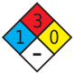
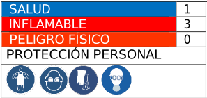
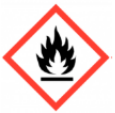
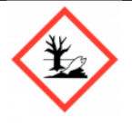
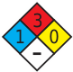

<!-- pagina 1 -->

049

> Texto OCR de la imagen: TECNIS-DECOR

## HOJA DE SEGURIDAD IMPRA

Página 1 de 4

## 1. IDENTIFICACION DEL FABRICANTE Y DE LA SUBSTANCIA QUIMICA

Empresa:

Nit:

TECNIDECOR S.A.S

900112215-2

Pbx:

444 49 44

Nombre del Producto:

IMPRA

Código del producto:

049

Sinónimos:

LASSUR

Fórmula:

Mezcla base solvente de hidrocarburos.

Número UN:

1268

Clase UN:

1-3-0

Fecha de actualización: Octubre de 2018

## 2. COMPOSICION, INFORMACION SOBRE INGREDIENTES

Resina

Solvente

38%

25%

Aditivos

7%

Extenders

30%

## 3. IDENTIFICACION DE RIESGOS

Inhalación: Los vapores tienen bajo grado de toxicidad, pero las nieblas pueden causar pulmonía. Garganta seca con tos, congestión de pecho a baja concentración, somnolencia. Mareo, dolor de cabeza, somnolencia.

Puede producir grave depresión del sistema nervioso.

Ingestión: Produce náuseas y vómito.

Inhalación: Cantidades minúsculas que absorban los pulmones y subsecuentemente produzcan vómito, pueden causar daños severos a pulmones. Inconsciencia. Convulsión.

La aspiración del material a los pulmones produce neumonitis química la cual puede ser fatal.

Contacto con la piel: Causa irritación. Dermatitis.

Contacto con los ojos: Irritante a los ojos pero no daña sus tejidos. Enrojecimiento.

Salud 1 - Inflamabilidad 3 Reactividad 0.

> Texto OCR de la imagen: SALUD INFLAMABLE ¡EM PELIGRO FÍSICO. EM PROTECCIÓN PERSONAL

## 4. PRIMEROS AUXILIOS

En caso de salpicadura del producto en los ojos, aplique agua corriente durante 15 minutos, no aplique agua a presión, solo deje que fluya en el ojo. Luego consulte al médico. En caso de contacto del producto con la piel, lave con abundante agua y jabón común. Si presenta irritación consulte al médico. En caso de ingestión, no administre ninguna sustancia, no induzca el vómito, consulte inmediatamente al médico y lleve la etiqueta donde se identifica el producto ingerido. Si al manipular el producto, presenta malestar, salga a una zona ventilada y retírese la ropa que tenga impregnada del producto.

<!-- pagina 2 -->

049

> Texto OCR de la imagen: TECNIS-DECOR

## HOJA DE SEGURIDAD IMPRA

Página 2 de 4

## 5. COMBATE DE INCENDIOS

- Incendio: Punto de inflamación (ºC): 43 Temperatura de autoignición (ºC): 210- 280 (Dependiendo de la composición) Limites de inflamabilidad en el aire % volumen: Lel: 0.6 ; Uel: 8.0 ¡Líquido y vapor extremadamente inflamables!. Los contenedores pueden explotar cuando se calientan. Sus vapores viajan rápidamente hasta la fuente de ignición y pueden retornar envueltos en llamas. Por encima de 43°C forma mezcla explosiva vapor-aire. El contacto con oxidantes fuertes puede producir incendio. Es sensible a descargas estáticas.
- Medios de extinción adecuados: Polvo químico seco, espuma y niebla de agua. El agua puede ser inefectiva y esparcir las llamas por ser el producto menos denso que esta.
- Productos de la combustión: Humos tóxicos de monóxido de carbono y dióxido de carbono.
- Instrucciones para combatir el fuego: El personal debe emplear respiradores cuando combate el fuego. Si es posible se debe cerrar el flujo de combustible en su origen. Mantenga refrigerados los contenedores con roció de agua desde una distancia segura o con equipo auto soportado.

## 6. LIBERACIONES ACCIDENTALES

- Identifique el producto
- Evite el contacto con el producto y la inhalación de los vapores desprendidos.
- Equiparse adecuadamente para la atención del derrame
- Evacue o aísle el área de peligro.
- Si es posible controle la fuente del derrame.
- Restringir el acceso de personas que no usen equipo, ni ropa de protección.
- Eliminar todas las fuentes de ignición. Ventilar la zona de derrame o fuga.
- Evite la entrada del producto a alcantarillados y/o fuentes de agua. ¡Riesgo de Explosión!
- Contenga el derrame
- Absorba el líquido con un material inerte y seco(vermiculita, arena, tierra o con un material similar)
- No use materiales combustibles como el aserrín
- Recoja el producto. Use herramientas y equipo que no produzcan chispas.
- Disponga adecuadamente los residuos.

## 7.MANEJO Y ALMACENAJE

- Empaque: No tiene acción corrosiva sobre los metales y puede ser empacado en acero o aluminio.
- Almacenamiento: Lugares ventilados, frescos y secos. Lejos de fuentes de calor e ignición. Separado de materiales incompatibles. Rotular los recipientes adecuadamente y mantenerlos bien cerrados. Almacenar en área de productos inflamables.
- Manejo: Usar siempre protección personal así sea corta la exposición o la actividad que realice con el producto.

Mantener estrictas normas de higiene, no fumar, ni comer en el sitio de trabajo.

Usar las menores cantidades posibles.

Conocer en dónde está el equipo para la atención de emergencias. Leer las instrucciones de la etiqueta antes de usar el producto. Rotular los recipientes adecuadamente.

Manejar alejado de fuentes e ignición y retirado de fuentes de calor.

Los recipientes deben ser enlazados y puestos a tierra cuando se realizan transferencias para evitar las chispas estáticas

## 8. CONTROLES DE EXPOSICION, PROTECCION PERSONAL

- Protección de los ojos y rostro: Gafas de seguridad para químicos.
- Protección de piel: Guantes largos de seguridad, botas de caucho con resistencia a hidrocarburos.
- Protección respiratoria: Respirador apropiado con filtro para vapores orgánicos
- Protección en caso de emergencia: Equipo de respiración autónomo (SCBA) y ropa de protección TOTAL.
- Controles de ingeniería: Ventilación local y general, para asegurar que la concentración no exceda los límites de exposición ocupacional o se mantenga lo más baja posible.

Garantizar el control de las condiciones del proceso.

Suministrar aire de reemplazo continuamente para suplir el aire removido.

Disponer de duchas y estaciones lavaojos.

<!-- pagina 3 -->

049

> Texto OCR de la imagen: TECNIS-DECOR *

## HOJA DE SEGURIDAD IMPRA

## 9. PROPIEDADES FISICAS Y QUIMICAS.

Aspecto:

Olor:

Liquido Característico.

Gravedad Específica (Agua=1): 0.79 / 20°C Punto de

Ebullición (ºC):

120-180.

Punto de Fusión (ºC):

-40 Densidad relativa del vapor (Aire=1): 4.8

Presión de vapor (mm Hg):

7.0 / 30°C

Solubilidad:

Insoluble en agua.

## 10. ESTABILIDAD Y REACTIVIDAD

Estabilidad química: Estable bajo condiciones normales.

El calor puede contribuir a la inestabilidad.

Condiciones a evitar: Materiales incompatibles, fuentes de ignición, chispas o llama directa.

Materias a evitar: Agua, sustancias oxidantes como el cloro líquido y el oxígeno concentrado.

Incompatibilidades con otros materiales: Agua, agentes oxidantes.

Productos de descomposición peligrosa: Monóxido y dióxido de carbono entre otros compuestos, se generan durante la exposición al calor o altas temperaturas.

## 11. INFORMACION TOXICOLOGICA.

Test: LC50 - Vía: Vapor de inhalación - Especies: Rata &gt; 4951 mg/m3 - Duración: 4h Test: LD50 - Vía: Oral - Especies: Rata &gt; 5000 mg/kg Test: LD50 - Vía: Piel - Especies: Conejo &gt; 5000 mg/kg

Contacto ocular Irritante

Contacto cutáneo No irritante

## 12. INFORMACION ECOLOGICA.

Persistencia / Durabilidad: Producto que persiste en el tiempo y no se degrada fácilmente

Inestabilidad: Producto estable en el tiempo Bio-acumulación: N.A

Efectos sobre el ambiente: Producto tóxico para peces, mamíferos, aves e insectos

## 13. CONSIDERACIONES SOBRE LA DISPOSICION.

Los residuos de este producto están clasificados como peligrosos (Clase 3: líquido inflamable,. De no ser posible la recuperación se sugiere incinerar bajo condiciones controladas, de acuerdo a regulaciones ambientales vigentes locales

El envase vacío contendrá residuos peligrosos. Obedezca todas las precauciones dadas en el envase. Manténgase alejado del calor, chispas o llamas. No use soldadoras o sopletes de corte en el envase o cerca de él.

No distribuya, disponga, use o facilite el envase vacío, excepto para el almacenamiento y transporte del producto original. Elimine todos los residuos peligrosos del envase, por ejemplo, limpiando con un paño húmedo. La limpieza deberá incluir la parte interna de la tapa y el anillo de cierre. (

## 14. INFORMACION SOBRE EL TRANSPORTE.

No transporte con sustancias explosivas, gases tóxicos, materiales combustibles espontáneamente, agentes oxidantes, peróxidos orgánicos, sustancias radiactivas.

Clase IMO: 3, Líquido Inflamable

U.N.: 1268

Grupo de embalaje: III

<!-- pagina 4 -->

049

> Texto OCR de la imagen: TECNIS-DECOR

## HOJA DE SEGURIDAD IMPRA

Página 4 de 4

## 15. INFORMACION SOBRE REGLAMENTACION.

Algunos de sus componentes estan regulados para el transporte, se debe dar cumplimiento al Decreto 1609 de 2002. Ministerio de Transporte.

NOTA: La información proporcionada cubre lo descrito en la hoja de seguridad. Se requiere la atención del usuario hacia la existencia de disposiciones complementarias. Consultar las regulaciones nacionales, internacionales y locales aplicables.

## 16. OTRA INFORMACION.

Esta hoja de seguridad tiene como fin sólo a brindar una guía basada en la Norma NTC 4435. Para el manejo del material con la precaución apropiada Las personas que reciban la información deben ejercer su propio criterio para determinar la conveniencia del uso de este producto para un fin específico. TECNIDECOR S.A.S no se hace responsable de ningún daño causado a propiedades o a personas por el uso inadecuado de nuestros productos, ya que no conocemos la manipulación ni las precauciones que cada cliente tiene en el almacenamiento.
