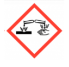

<!-- pagina 1 -->

137

> Texto OCR de la imagen: TECNIS-DECOR

## HOJA DE SEGURIDAD SELLADOR NITROCELULOSICO

Página 1 de 4

## 1. IDENTIFICACION DEL FABRICANTE Y DE LA SUBSTANCIA QUIMICA

Empresa:

Nit:

TECNIDECOR S.A.S

900112215-2

Pbx:

444 49 44

Nombre del Producto: SELLADOR NITROCELULOSICO

Código del producto:

137

Sinónimos:

N/A

Fórmula:

CuO + As2O5 + CrO3.

Número UN:

1263

Clase UN:

1-2-0

Fecha de actualización: Octubre de 2018

## 2. COMPOSICION, INFORMACION SOBRE INGREDIENTES

Resina

Solvente

38%

25%

Aditivos

7%

Extenders

30%

## 3. IDENTIFICACION DE RIESGOS

El envase vacío contendrá residuos peligrosos.

Obedezca todas las precauciones dadas en el envase.

Manténgase alejado del calor, chispas o llamas.

No use soldadoras o sopletes de corte en el envase o cerca de él.

No distribuya, disponga, use o facilite el envase vacío, excepto para el almacenamiento y transporte del producto original. Elimine todos los residuos peligrosos del envase, por ejemplo, limpiando con un paño húmedo.

La limpieza deberá incluir la parte interna de la tapa y el anillo de cierre. (Deseche el paño siguiendo las instrucciones para el derrame de nitrocelulosa).

Elimine o borre todas las etiquetas. Después ofrezca el envase para su reciclamiento/ reacondicionamiento u horade o destruya de alguna forma el envase vacío y deseche en instalaciones en donde se permita el desecho no peligroso.

> Texto OCR de la imagen: 1 INFLAMABLE 2 PELIGRO FÍSICO po | PROTECCIOON PERSONAL

## 4. PRIMEROS AUXILIOS

En caso de salpicadura del producto en los ojos, aplique agua corriente durante 15 minutos, no aplique agua a presión, solo deje que fluya en el ojo. Luego consulte al médico. En caso de contacto del producto con la piel, lave con abundante agua y jabón común. Si presenta irritación consulte al médico. En caso de ingestión, no administre ninguna sustancia, no induzca el vómito, consulte inmediatamente al médico y lleve la etiqueta donde se identifica el producto ingerido. Si al manipular el producto, presenta malestar, salga a una zona ventilada y retírese la ropa que tenga impregnada del producto.

## 5. COMBATE DE INCENDIOS

Actuar conforme el Plan de Emergencia Interior y las Fichas Informativas sobre actuación ante accidentes y otras emergencias. Suprimir cualquier fuente de ignición.

En caso de incendio, refrigerar los recipientes y tanques de almacenamiento de productos susceptibles a inflamación, explosión o BLEVE como consecuencia de elevadas temperaturas.

<!-- pagina 2 -->

137

> Texto OCR de la imagen: TECNIS-DECOR

## HOJA DE SEGURIDAD SELLADOR NITROCELULOSICO

Página 2 de 4

Evitar el vertido de los productos empleados en la extinción del incendio al medio acuático. Disposiciones adicionales: En función de la magnitud del incendio puede hacerse necesario el uso de ropa protectora completa y equipo de respiración autónomo. Disponer de un mínimo de instalaciones de emergencia o elementos de actuación (mantas ignífugas, botiquín portátil,) conforme al R.D.486/1997 y posteriores modificaciones 5 Recomendaciones para el personal de lucha contra incendios: Como consecuencia de la combustión o descomposición térmica se generan subproductos de reacción que pueden resultar altamente tóxicos y, consecuentemente, pueden presentar un riesgo elevado para la salud. Peligros específicos derivados de la sustancia o la mezcla: Emplear preferentemente extintores de polvo polivalente (polvo ABC), alternativamente utilizar espuma física o extintores de dióxido de carbono (CO2), de acuerdo al Reglamento de instalaciones de protección contra incendios (R.D. 1942/1993 y posteriores modificaciones). NO SE RECOMIENDA emplear agua a chorro como agente de extinción.

6. LIBERACIONES ACCIDENTALES

Eliminar las fuentes de ignición. ¡No fumar! Asegurar de que haya suficiente ventilación o aire fresco. Evítese el contacto con los ojos o la piel. Evítese la inhalación de vapores. Utilizar equipo/indumentaria protectora adecuada. Verifique con el fabricante del equipo de protección personal. L as herramientas que se utilicen en el manejo de la nitrocelulosa deben ser de materiales no ferrosos, como cobre o bronce, o madera, es decir, que no desprendan chispas al chocar. La nitrocelulosa derramada debe humedecerse perfectamente con agua en abundancia, limpiarse y recogerse cuidadosamente y mantenerse en un contenedor hermético al agua, firmemente cerrado. Evitar que la nitrocelulosa derramada llegue a contaminar corrientes de agua, desagües, suelo o vegetación.

## 7.MANEJO Y ALMACENAJE

Mantenga fuera del alcance de los niños. No ingiera el producto. Evite el contacto con la piel o los ojos y la inhalación de los vapores usando equipos apropiados de seguridad como guantes, gafas de seguridad y mascarilla de cartucho para solventes orgánicos. No consuma alimentos mientras manipula el producto. Aplique en un lugar con buena ventilación, alejado de toda fuente de calor, ya que el producto desprende vapores que podrían entrar en combustión en presencia de chispas, llamas o cualquier otra fuente de ignición. Mantenga el recipiente bien tapado mientras no esté utilizando el producto. Almacene en los recipientes originales cerrados, lejos de toda fuente de ignición, bajo techo en un área fresca, seca y bien ventilada, a una temperatura inferior a 30°C. En caso de contacto del producto con fuentes de calor o expuestos al fuego, use agentes extintores de polvo químico seco. No vierta el producto en desagües, sobre el suelo, en quebradas o ríos. En caso de escape o derrame recoja el material en recipientes para evitar la contaminación de las fuentes de agua o alcantarillados. Disponga de los residuos respetando las normas y regulaciones locales. Para retirar (desprender) el producto (aplicado) que este seco utilice gafas de seguridad y mascarilla para material particulado (polvos).

## 8. CONTROLES DE EXPOSICION, PROTECCION PERSONAL

Medidas para reducir la posibilidad de exposición : Ropa que cubra la totalidad del cuerpo incluyendo brazos y piernas en forma completa, cuyo material sea impermeable al producto Límites permisibles ponderado (LPP) y Absoluto (LPA) : 0.06 mg/m3 ; 0.03mg/m3 Protección respiratoria : Utilizar mascarilla tipo full face o bien un respirador autónomo Guantes de protección : Guante de plástico o caucho Protección de la vista : Lentes que permitan completa protección a la vista Otros equipos de protección : Delantal de caucho y botas impermeable al producto Ventilación : Trabajar en zonas que permitan la libre circulación del producto y en caso contrario utilizar ventilación forzada

<!-- pagina 3 -->

> Texto OCR de la imagen: TECNIS-DECOR *

## HOJA DE SEGURIDAD SELLADOR NITROCELULOSICO

Página 3 de 4

## 9. PROPIEDADES FISICAS Y QUIMICAS.

Forma: Liquido espeso

Color: blanco

Olor: el de los alcoholes humectantes

Densidad a granel: 500-600 Kg/m3

Viscosidad: no es aplicable S

olubilidad en agua: La NC es soluble en esteres, cetonas y éteres glicólicos

## 10. ESTABILIDAD Y REACTIVIDAD

La estabilidad del producto en el envase es de 12 meses contados a partir de la fecha de fabricación indicada en el código de barras. Pasado este tiempo el producto puede estar en buen estado, pero se recomienda su revisión por parte del Servicio Técnico. Una vez abierto el envase, el producto debe ser utilizado en el menor tiempo posible siguiendo las recomendaciones de almacenamiento.

## 11. INFORMACION TOXICOLOGICA.

La nitrocelulosa se ha venido utilizando durante muchos años sin señal de ocasionar efectos adversos. La toxicidad depende del agente humectante. Etanol Isopropanol Nitrocelulosa Oral DL50, Rata 6200 5045 &gt; 5000 mg/kg Inhalación DL50, Rata &gt; 8000 mg/l 16,000 ppm 8hr - Dérmico conejo &gt; 20000 12800 mg/kg - Contacto ocular Irritante Contacto cutáneo No irritante

## 12. INFORMACION ECOLOGICA.

Inestabilidad : Producto estable en el tiempo Persistencia / Degrabilidad : Producto que persiste en el tiempo y no se degrada fácilmente Bio-acumulación : Producto que se elimina por las fecas, dependiendo de la concentración y el metabolismo de cada persona Efectos sobre el ambiente : Producto tóxico para peces, mamíferos, aves e insectos

## 13. CONSIDERACIONES SOBRE LA DISPOSICION.

El envase vacío contendrá residuos peligrosos. Obedezca todas las precauciones dadas en el envase. Manténgase alejado del calor, chispas o llamas. No use soldadoras o sopletes de corte en el envase o cerca de él. No distribuya, disponga, use o facilite el envase vacío, excepto para el almacenamiento y transporte del producto original. Elimine todos los residuos peligrosos del envase, por ejemplo, limpiando con un paño húmedo. La limpieza deberá incluir la parte interna de la tapa y el anillo de cierre. (Deseche el paño siguiendo las instrucciones para el derrame de nitrocelulosa). Elimine o borre todas las etiquetas.

Después ofrezca el envase para su reciclamiento/ reacondicionamiento u horade o destruya de alguna forma el envase vacío y deseche en instalaciones en donde se permita el desecho no peligroso.

## 14. INFORMACION SOBRE EL TRANSPORTE.

Veneno, No almacenar junto a alimentos Nº UN : 2922

Grupo de embalaje II

## 15. INFORMACION SOBRE REGLAMENTACION.

Algunos de sus componentes estan regulados para el transporte, se debe dar cumplimiento al Decreto 1609 de 2002. Ministerio de Transporte.

<!-- pagina 4 -->

137

> Texto OCR de la imagen: TECNIS-DECOR *

## HOJA DE SEGURIDAD SELLADOR NITROCELULOSICO

Página 4 de 4

NOTA: La información proporcionada cubre lo descrito en la hoja de seguridad. Se requiere la atención del usuario hacia la existencia de disposiciones complementarias. Consultar las regulaciones nacionales, internacionales y locales aplicables.

## 16. OTRA INFORMACION.

Esta hoja de seguridad tiene como fin sólo a brindar una guía basada en la Norma NTC 4435. Para el manejo del material con la precaución apropiada Las personas que reciban la información deben ejercer su propio criterio para determinar la conveniencia del uso de este producto para un fin específico. TECNIDECOR S.A.S no se hace responsable de ningún daño causado a propiedades o a personas por el uso inadecuado de nuestros productos, ya que no conocemos la manipulación ni las precauciones que cada cliente tiene en el almacenamiento.
