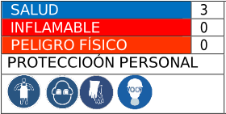
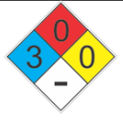
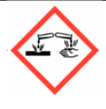
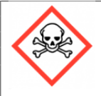
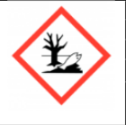

<!-- pagina 1 -->

136

> Texto OCR de la imagen: TECNIS-DECOR

## HOJA DE SEGURIDAD INMUNIZANTE UNIVERSAL

Página 1 de 4

## 1. IDENTIFICACION DEL FABRICANTE Y DE LA SUBSTANCIA QUIMICA

Empresa:

Nit:

TECNIDECOR S.A.S

900112215-2

Pbx:

444 49 44

Nombre del Producto:

INMUNIZANTE UNIVERSAL

Código del producto:

136

Sinónimos:

CCA

Fórmula:

CuO + As2O5 + CrO3.

Número UN:

2922

Clase UN:

3-0-0

Fecha de actualización: Octubre de 2018

## 2. COMPOSICION, INFORMACION SOBRE INGREDIENTES

Nombre Químico :

Formula Química :

Oxido de cobre

Oxido de arsénico

Óxido de cromo

CuO + As2O5 + CrO3

Nº CAS :

1317 38 0

12044 50 7

1333 82 - 0

## 3. IDENTIFICACION DE RIESGOS

Clasificación de Riesgo : 6.1

Inhalación: Puede provocar irritación a las vías respiratorias

Contacto con la piel: Producto altamente soluble en agua, por lo que es fácilmente absorbido por la piel, además puede provocar quemaduras severas y ulceración

Contacto con los ojos: Puede provocar irritación y severas quemaduras y ulceraciones oculares

Ingestión: Puede producir quemaduras serias en todo el sistema gastrointestinal, problemas respiratorios y digestivos Efectos de una sobreexposición crónica (largo plazo) : Puede provocar anemias, neuropatia, reducción de la circulación periférica, problemas cardiovasculares y sistema linfático

Condiciones médicas que se verán agravadas con la exposición al producto: Dermatitis, problemas respiratorios

Peligros para el medio ambiente: Producto altamente tóxico para peces, mamíferos, aves e insectos

Peligros especiales del producto: Es un producto de características oxidantes, aunque no es combustible, los vapores ocasionados por la elevación de temperatura pueden ser muy dañinos para la salud

> Texto OCR de la imagen: SALUD INFLAMABLE s§s FO ¡PELIGRO FÍSICO EM PROTECCIOÓN PERSONAL

## 4. PRIMEROS AUXILIOS

En caso de contacto accidental con el producto, proceder de acuerdo con

Inhalación : Llevar a la persona afectada a una zona libre

Contacto con la piel : Debe procederse a un lavado inmediato con abundante agua y jabón. Pedir asistencia médica Contacto con los ojos : Lavar con abundante agua corriente durante a lo menos quince minutos. Pedir asistencia médica Ingestión : En caso de ingesta accidental debe procederse a la ingesta de abundante leche, clara de huevo o solución de gelatina. Si no se dispone de estos elementos, beba agua en abundancia, induzca al vomito con salmuera. Llamar de inmediato a un médico

<!-- pagina 2 -->

136

> Texto OCR de la imagen: TECNIS-DECOR

## HOJA DE SEGURIDAD INMUNIZANTE UNIVERSAL

Página 2 de 4

Notas para el médico tratante : Este producto es un estimulante metabólico que provoca hipertermia y el paciente debe ser tratado de acuerdo a los síntomas.

5. COMBATE DE INCENDIOS

Agentes de Extinción : La emergencia de incendio puede controlarse con cualquier medio de extinción, permitir el enfriamiento de los envases Procedimientos especiales para combatir el fuego : No es un producto combustible ni explosivo, pero se debe evitar el contacto con fuentes de calor, ya que a temperaturas altas este puede descomponer gases que pueden ser tóxicos Equipos de protección personal para el combate del fuego : La ropa debe ser la adecuada a dicha emergencia, usar mascara full face, o bien un respirador autónomo

6. LIBERACIONES ACCIDENTALES

Medidas de Emergencias a tomar si hay derrames del material : Evacuar el lugar y evitar la inhalación del producto. En caso de derrame accidental se recomienda el uso de 45 kg de cal o 175 kg de cemento seco por cada 100 kg Equipo de protección personal para atacar la emergencia : Ropa adecuada a la emergencia, y utilizar máscara full face o bien un respirador autónomo Precauciones a tomar para evitar daños al ambiente : Los empaques no deben ser abiertos durante el almacenaje sino al momento de ser empleados. El preservante debe guardarse en lugares frescos, protegidos de la lluvia y lejos de toda fuente de calor. Nunca eliminar restos de producto en lagos, ríos o alguna fuente de agua. Métodos de limpieza : Utilizar barrido luego previo mezclar con cal o cemento Método de eliminación de desechos : Utilizar algún vertedero autorizado o bien hablar con su proveedor

## 7.MANEJO Y ALMACENAJE

Recomendaciones Técnicas: Es un preservante a base de óxidos diluidos de cromo, cobre y arsénico que se usa exclusivamente en la impregnación a presión y vacío de productos forestales tales como; madera de construcción, postes

eléctricos, estacas de uso agrícola, construcciones marinas, pilotes. Precauciones a tomar: Los empaques no deben ser abiertos durante el almacenaje sino al momento de ser empleados Recomendaciones sobre manipulación Segura, específicas : Nunca golpear o ejercer presión sobres los envases del producto, evitar sus salpicaduras Condiciones de almacenamiento : El preservante debe guardarse en lugares frescos, protegidos de la lluvia y lejos de toda fuente de calor Embalaje recomendados y No adecuados : Envases plásticos. Materiales metálicos son no recomendados por ser fácilmente

oxidables, es posible utilizar aquellos que posean recubrimiento tipo epóxico o similar

## 8. CONTROLES DE EXPOSICION, PROTECCION PERSONAL

Medidas para reducir la posibilidad de exposición : Ropa que cubra la totalidad del cuerpo incluyendo brazos y piernas en forma completa, cuyo material sea impermeable al producto Límites permisibles ponderado (LPP) y Absoluto (LPA) : 0.06 mg/m3 ; 0.03mg/m3 Protección respiratoria : Utilizar mascarilla tipo full face o bien un respirador autónomo Guantes de protección : Guante de plástico o caucho Protección de la vista : Lentes que permitan completa protección a la vista Otros equipos de protección : Delantal de caucho y botas impermeable al producto Ventilación : Trabajar en zonas que permitan la libre circulación del producto y en caso contrario utilizar ventilación forzada

9. PROPIEDADES FISICAS Y QUIMICAS.

Estado físico : Líquido Apariencia y olor : Oleoso, color café verdoso

Concentración :

60 % pH :

<!-- pagina 3 -->

136

> Texto OCR de la imagen: TECNIS-DECOR *

## HOJA DE SEGURIDAD INMUNIZANTE UNIVERSAL

Temperatura de descomposición : &gt; 60 ºC Punto de inflamación : N. A. Temperatura de autoignición : N.A. Propiedades explosivas : No posee Velocidad de propagación de la llama:N. A. Presión de vapor a 20ºC : Sin información Densidad de vapor : N.A. Densidad a 20ºC : 1.85 g/ml Solubilidad en agua y otros : Totalmente soluble en agua. Insoluble en solventes orgánicos

10. ESTABILIDAD Y REACTIVIDAD

Estabilidad :Estable, pero a temperaturas sobre 60 º pierde sus propiedades de mezcla homogénea. Condiciones que deben evitarse :Fuentes de calor, intemperie. Incompatibilidad (materiales que deben evitarse) : Incompatible con metales, álcalis Productos peligrosos de la descomposición :No posee Productos peligrosos de la combustión :Los que posee la mezcla Polimerización peligrosa :No tiene

## 11. INFORMACION TOXICOLOGICA.

Toxicidad aguda : Oral LD50 : 50 mg/kg (ratas adultas) Toxicidad crónica o de largo plazo : Dérmica LD50 : 450 mg/kg (roedores) Efectos locales : Daños al corazón, hígado y riñones Sensibilización alérgica : Dermatitis, verrugas y ulceraciones

## 12. INFORMACION ECOLOGICA.

Inestabilidad : Producto estable en el tiempo Persistencia / Degrabilidad : Producto que persiste en el tiempo y no se degrada fácilmente Bio-acumulación : Producto que se elimina por las fecas, dependiendo de la concentración y el metabolismo de cada persona Efectos sobre el ambiente : Producto tóxico para peces, mamíferos, aves e insectos

## 13. CONSIDERACIONES SOBRE LA DISPOSICION.

Método de eliminación del producto en los residuos : Usar algún vertedero autorizado Los envases vacíos deben ser triple lavados con agua. Las aguas de lavado pueden utilizarse para la dilución del producto. Los envases se deben destruir para evitar su utilización para otros fines y comercializados como chatarra para reciclaje.

## 14. INFORMACION SOBRE EL TRANSPORTE.

Veneno, No almacenar junto a alimentos Nº UN : 2922 Grupo de embalaje II

15. INFORMACION SOBRE REGLAMENTACION.

Algunos de sus componentes estan regulados para el transporte, se debe dar cumplimiento al Decreto 1609 de 2002. Ministerio de Transporte. NOTA: La información proporcionada cubre lo descrito en la hoja de seguridad. Se requiere la atención del usuario hacia la existencia de disposiciones complementarias. Consultar las regulaciones nacionales, internacionales y locales aplicables.

<!-- pagina 4 -->

136

> Texto OCR de la imagen: TECNIS-DECOR

## HOJA DE SEGURIDAD INMUNIZANTE UNIVERSAL

Página 4 de 4

## 16. OTRA INFORMACION.

Esta hoja de seguridad tiene como fin sólo a brindar una guía basada en la Norma NTC 4435. Para el manejo del material con la precaución apropiada Las personas que reciban la información deben ejercer su propio criterio para determinar la conveniencia del uso de este producto para un fin específico. TECNIDECOR S.A.S no se hace responsable de ningún daño causado a propiedades o a personas por el uso inadecuado de nuestros productos, ya que no conocemos la manipulación ni las precauciones que cada cliente tiene en el almacenamiento.
