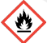
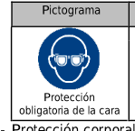
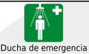
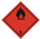
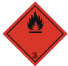
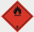

<!-- pagina 1 -->

## Ficha de datos de seguridad

## ESMALTE TOP QUALITY AZUL MEDIO 1795 10013098

## SECCIÓN 1: IDENTIFICACIÓN DEL PRODUCTO

1.1 Identificador SGA del producto: ESMALTE TOP QUALITY AZUL MEDIO 1795

10013098

## 1.2 Uso recomendado del producto químico y restricciones:

Usos pertinentes: Pintura

Usos desaconsejados: Todo aquel uso no especificado en este epígrafe ni en el epígrafe 7.3

## 1.3 Datos sobre el proveedor:

Pintuco

Autopista Medellín Bogotá Km 37 Vía Belén Rionegro Km 1 054040 Rionegro - Antioquia - Colombia Tfno.: 57 4 569 81 00 contacto@pintuco.com http://www.pintuco.com

- 1.4 Número de teléfono para emergencias: 57 4 561 22 23

## SECCIÓN 2: IDENTIFICACIÓN DEL PELIGRO O PELIGROS

## 2.1 Clasificación de la sustancia o de la mezcla:

## SGA:

La clasificación del producto se ha realizado conforme con al decreto 1496 de 2018, por el cual se adopta el Sistema Globalmente Armonizado de Clasificación y Etiquetado de Productos Químicos y se dictan otras disposiciones en materia de seguridad química.

Acuático agudo. 3: Peligrosidad aguda para el medio ambiente acuático, Categoría 3, H402

Acuático crónico. 3: Peligrosidad crónica para el medio ambiente acuático, Categoría 3, H412

Irrit. Cut. 2: Irritación cutánea, categoría 2, H315

Liq. Infl. 3: Líquidos inflamables, Categoría 3, H226

Sens. Cut. 1A: Sensibilización cutánea, Categoría 1A, H317

STOT única 3: Toxicidad específica con efectos de somnolencia y vértigo (exposición única), Categoría 3, H336

Tox. Asp. 1: Peligro por aspiración, Categoría 1, H304

## 2.2 Elementos de las etiquetas del SGA, incluidos los consejos de prudencia:

## SGA:

Peligro

## Indicaciones de peligro:

Acuático crónico. 3: H412 - Nocivo para los organismos acuáticos, con efectos nocivos duraderos

Irrit. Cut. 2: H315 - Provoca irritación cutánea

Liq. Infl. 3: H226 - Líquido y vapores inflamables

Sens. Cut. 1A: H317 - Puede provocar una reacción cutánea alérgica

STOT única 3: H336 - Puede provocar somnolencia o vértigo

Tox. Asp. 1: H304 - Puede ser mortal en caso de ingestión y de penetración en las vías respiratorias

## Consejos de prudencia:

P101: Si se necesita consultar a un médico, tener a mano el recipiente o la etiqueta del producto

P102: Mantener fuera del alcance de los niños

P210: Mantener alejado del calor, superficies calientes, chispas llamas al descubierto y otras fuentes de ignición. No fumar

P264: Lavarse cuidadosamente después de la manipulación

P280: Usar guantes/ropa de protección/equipo de protección para los ojos/la cara

P304+P340: EN CASO DE INHALACIÓN: Transportar a la persona al aire libre y mantenerla en una posición que le facilite la respiración

P370+P378: En caso de incendio: Utilizar extintor de polvo ABC para la extinción

P501: Eliminar el contenido/recipiente mediante el sistema de recogida selectiva habilitado en su municipio

## Sustancias que contribuyen a la clasificación

Destilados (petróleo), fracción ligera tratada con hidrógeno; Bis(2-etilhexanoato) de cobalto

## 2.3 Otros peligros que no conducen a una clasificación:

No relevante

<!-- pagina 2 -->

## Ficha de datos de seguridad

según Decreto 1496 de 2018

## ESMALTE TOP QUALITY AZUL MEDIO 1795 10013098

## SECCIÓN 3: COMPOSICIÓN/INFORMACIÓN SOBRE LOS COMPONENTES

## 3.1 Sustancias:

No aplicable

## 3.2 Mezclas:

Descripción química: Mezcla a base de productos químicos

## Componentes:

De acuerdo al Decreto 1496 de 2018, el producto presenta:

| Identificación   | Nombre químico/clasificación                                 | Concentración   |
|------------------|--------------------------------------------------------------|-----------------|
| CAS: 64742-47-8  | Destilados (petróleo), fracción ligera tratada con hidrógeno | 50 - <75 %      |
| CAS: 136-52-7    | Bis(2-etilhexanoato) de cobalto                              | <1 %            |

Para ampliar información sobre la peligrosidad de la sustancias consultar las secciones 8, 11, 12, 15 y 16. La clasificación respecto Carcinogenicidad de las sustancias se ha establecido en función de las monografías de la IARC adecuándola al sistema de clasificación SGA, para información sobre la clasificación IARC consulte la sección 11.

## SECCIÓN 4: PRIMEROS AUXILIOS

## 4.1 Descripción de los primeros auxilios necesarios:

Los síntomas como consecuencia de una intoxicación pueden presentarse con posterioridad a la exposición, por lo que, en caso de duda, exposición directa al producto químico o persistencia del malestar solicitar atención médica, mostrándole la FDS de este producto.

## Por inhalación:

Sacar al afectado del lugar de exposición, suministrarle aire limpio y mantenerlo en reposo. En casos graves como parada cardiorespiratoria, se aplicarán técnicas de respiración artificial (respiración boca a boca, masaje cardíaco, suministro de oxígeno,etc.) requiriendo asistencia médica inmediata.

## Por contacto con la piel:

Quitar la ropa y los zapatos contaminados, aclarar la piel o duchar al afectado si procede con abundante agua fría y jabón neutro. En caso de afección importante acudir al médico. Si el producto produce quemaduras o congelación, no se debe quitar la ropa debido a que podría empeorar la lesión producida si esta se encuentra pegada a la piel. En el caso de formarse ampollas en la piel, éstas nunca deben reventarse ya que aumentaría el riesgo de infección.

## Por contacto con los ojos:

Enjuagar los ojos con abundante agua a temperatura ambiente al menos durante 15 minutos. Evitar que el afectado se frote o cierre los ojos. En el caso de que el accidentado use lentes de contacto, éstas deben retirarse siempre que no estén pegadas a los ojos, de otro modo podría producirse un daño adicional. En todos los casos, después del lavado, se debe acudir al médico lo más rápidamente posible con la FDS del producto.

## Por ingestión/aspiración:

Requerir asistencia médica inmediata, mostrándole la FDS de este producto. No inducir al vómito, en el caso de que se produzca mantener inclinada la cabeza hacia delante para evitar la aspiración. En el caso de pérdida de consciencia no administrar nada por vía oral hasta la supervisión del médico. Enjuagar la boca y la garganta, ya que existe la posibilidad de que hayan sido afectadas en la ingestión. Mantener al afectado en reposo.

## 4.2 Síntomas/efectos más importantes, agudos o retardados:

Los efectos agudos y retardados son los indicados en las secciones 2 y 11.

## 4.3 Indicación de la necesidad de recibir atención médica inmediata y, en su caso, de tratamiento especial:

No relevante

## SECCIÓN 5: MEDIDAS DE LUCHA CONTRA INCENDIOS

## 5.1 Medios de extinción apropiados:

Emplear preferentemente extintores de polvo polivalente (polvo ABC), alternativamente utilizar espuma física o extintores de dióxido de carbono (CO2). NO SE RECOMIENDA emplear agua a chorro como agente de extinción.

- 5.2 Peligros específicos del producto químico:

<!-- pagina 3 -->

## Ficha de datos de seguridad

según Decreto 1496 de 2018

## ESMALTE TOP QUALITY AZUL MEDIO 1795 10013098

## SECCIÓN 5: MEDIDAS DE LUCHA CONTRA INCENDIOS (continúa)

Como consecuencia de la combustión o descomposición térmica se generan subproductos de reacción que pueden resultar altamente tóxicos y, consecuentemente, pueden presentar un riesgo elevado para la salud.

## 5.3 Medidas especiales que deben tomar los equipos de lucha contra incendios:

En función de la magnitud del incendio puede hacerse necesario el uso de ropa protectora completa y equipo de respiración autónomo. Disponer de un mínimo de instalaciones de emergencia o elementos de actuación (mantas ignífugas, botiquín portátil,...).

## Disposiciones adicionales:

Actuar conforme el Plan de Emergencia Interior y las Fichas Informativas sobre actuación ante accidentes y otras emergencias. Suprimir cualquier fuente de ignición. En caso de incendio, refrigerar los recipientes y tanques de almacenamiento de productos susceptibles a inflamación, explosión como consecuencia de elevadas temperaturas. Evitar el vertido de los productos empleados en la extinción del incendio al medio acuático.

## SECCIÓN 6: MEDIDAS QUE DEBEN TOMARSE EN CASO DE VERTIDO ACCIDENTAL

## 6.1 Precauciones personales, equipo protector y procedimiento de emergencia:

Aislar las fugas siempre y cuando no suponga un riesgo adicional para las personas que desempeñen esta función. Evacuar la zona y mantener a las personas sin protección alejadas. Ante el contacto potencial con el producto derramado se hace obligatorio el uso de elementos de protección personal (ver sección 8). Evitar de manera prioritaria la formación de mezclas vapor-aire inflamables, ya sea mediante ventilación o el uso de un agente inertizante. Suprimir cualquier fuente de ignición. Eliminar las cargas electroestáticas mediante la interconexión de todas las superficies conductoras sobre las que se puede formar electricidad estática, y estando a su vez el conjunto conectado a tierra.

## 6.2 Precauciones relativas al medio ambiente:

Evitar a toda costa cualquier tipo de vertido al medio acuático. Contener adecuadamente el producto absorbido/recogido en recipientes herméticamente cerrados. Notificar a la autoridad competente en el caso de exposición al público en general o al medioambiente.

## 6.3 Métodos y materiales para la contención y limpieza de vertidos:

Se recomienda:

Absorber el vertido mediante arena o absorbente inerte y trasladarlo a un lugar seguro. No absorber en serrín u otros absorbentes combustibles. Para cualquier consideración relativa a la eliminación consultar la sección 13.

## 6.4 Referencias a otras secciones:

Ver secciones 8 y 13.

## SECCIÓN 7: MANIPULACIÓN Y ALMACENAMIENTO

## 7.1 Precauciones que se deben tomar para garantizar una manipulación segura:

- A.- Precauciones generales

Cumplir con la legislación vigente en materia de prevención de riesgos laborales. Mantener los recipientes herméticamente cerrados. Controlar los derrames y residuos, eliminándolos con métodos seguros (sección 6). Evitar el vertido libre desde el recipiente. Mantener orden y limpieza donde se manipulen productos peligrosos.

- B.- Recomendaciones técnicas para la prevención de incendios y explosiones.

Trasvasar en lugares bien ventilados, preferentemente mediante extracción localizada. Controlar totalmente los focos de ignición (teléfonos móviles, chispas,…) y ventilar en las operaciones de limpieza. Evitar la existencia de atmósferas peligrosas en el interior de recipientes, aplicando en lo posible sistemas de inertización. Trasvasar a velocidades lentas para evitar la generación de cargas electroestáticas. Ante la posibilidad de existencia de cargas electroestáticas: asegurar una perfecta conexión equipotencial, utilizar siempre tomas de tierras, no emplear ropa de trabajo de fibras acrílicas, empleando preferiblemente ropa de algodón y calzado conductor. Cumplir con los requisitos esenciales de seguridad para equipos y con las disposiciones mínimas para la protección de la seguridad y salud de los trabajadores. Consultar la sección 10 sobre condiciones y materias que deben evitarse.

- C.- Recomendaciones técnicas para prevenir riesgos ergonómicos y toxicológicos.

Para control de exposición consultar la sección 8. No comer, beber ni fumar en las zonas de trabajo; lavarse las manos después de cada utilización, y despojarse de prendas de vestir y equipos de protección contaminados antes de entrar en las zonas para comer.

- D.- Recomendaciones técnicas para prevenir riesgos medioambientales

Debido a la peligrosidad de este producto para el medio ambiente se recomienda manipularlo dentro de un área que disponga de barreras de control de la contaminación en caso de vertido, así como disponer de material absorbente en las proximidades del mismo

- 7.2 Condiciones de almacenamiento seguro, incluidas cualesquiera incompatibilidades:

<!-- pagina 4 -->

## Ficha de datos de seguridad

según Decreto 1496 de 2018

## ESMALTE TOP QUALITY AZUL MEDIO 1795 10013098

## SECCIÓN 7: MANIPULACIÓN Y ALMACENAMIENTO (continúa)

- A.- Medidas técnicas de almacenamiento
- B.- Condiciones generales de almacenamiento.

Tª mínima:

Tª máxima:

5 ºC

30 ºC

Tiempo máximo:

18 meses

Evitar fuentes de calor, radiación, electricidad estática y el contacto con alimentos. Para información adicional ver epígraf e 10.5

## 7.3 Usos específicos finales:

Salvo las indicaciones ya especificadas no es preciso realizar ninguna recomendación especial en cuanto a los usos de este producto.

## SECCIÓN 8: CONTROLES DE EXPOSICIÓN/PROTECCIÓN PERSONAL

## 8.1 Parámetros de control:

Sustancias cuyos valores límite de exposición profesional han de controlarse en el ambiente de trabajo (ACGIH):

No aplica

## 8.2 Controles técnicos apropiados:

- A.- Medidas de protección individual, como equipo de protección personal (EPP)

Como medida de prevención se recomienda la utilización de equipos de protección individual básicos. Para más información sobre los equipos de protección individual (almacenamiento, uso, limpieza, mantenimiento, clase de protección,…) consultar el folleto informativo facilitado por el fabricante del EPP. Las indicaciones contenidas en este punto se refieren al producto puro. Las medidas de protección para el producto diluido podrán variar en función de su grado de dilución, uso, método de aplicación, etc. Para determinar la obligación de instalación de duchas de emergencia y/o lavaojos en los almacenes se tendrá en cuenta la normativa referente al almacenamiento de productos químicos aplicable en cada caso. Para más información ver epígrafes 7.1 y 7.2.

Toda la información aquí incluida es una recomendación siendo necesario su concreción por parte de los servicios de prevención de riesgos laborales al desconocer las medidas de prevención adicionales que la empresa pudiese disponer.

## B.- Protección respiratoria.

- C.- Protección específica de las manos.

| Pictograma                                        | EPP                                     | Observaciones                                                                                                                                                                                                      |
|---------------------------------------------------|-----------------------------------------|--------------------------------------------------------------------------------------------------------------------------------------------------------------------------------------------------------------------|
| Protección obligatoria del las vías respiratorias | Máscara con filtro para gases y vapores | Reemplazar cuando se detecte olor o sabor del contaminante en el interior de la máscara o adaptador facial. Cuando el contaminante no tiene buenas propiedades de aviso se recomienda el uso de equipos aislantes. |

> Texto OCR de la imagen: Protección obligatoria de las

| Pictograma                          | EPP                   | Observaciones                                                                                                                                                                                                                 |
|-------------------------------------|-----------------------|-------------------------------------------------------------------------------------------------------------------------------------------------------------------------------------------------------------------------------|
| Protección obligatoria de las manos | Guantes de protección | Reemplazar los guantes ante cualquier indicio de deterioro. Para periodos de exposición prolongados al producto para usuarios profesionales/industriales se hace recomendable la utilización de guantes de protección química |

Dado que el producto es una mezcla de diferentes materiales, la resistencia del material de los guantes no se puede calcular de antemano con total fiabilidad y por lo tanto tiene que ser controlados antes de su aplicación.

## D.- Protección ocular y facial

| Pictograma                        | EPP                                                     | Observaciones                                                                                                                                        |
|-----------------------------------|---------------------------------------------------------|------------------------------------------------------------------------------------------------------------------------------------------------------|
| Protección obligatoria de la cara | Gafas de seguridad contra salpicaduras y/o proyecciones | Limpiar a diario y desinfectar periódicamente de acuerdo a las instrucciones del fabricante. Se recomienda su uso en caso de riesgo de salpicaduras. |

E.- Protección corporal

> Texto OCR de la imagen: Pictograma Protección obligatoria de la cara Dry cora

<!-- pagina 5 -->

## Ficha de datos de seguridad

según Decreto 1496 de 2018

## ESMALTE TOP QUALITY AZUL MEDIO 1795

## 10013098

## SECCIÓN 8: CONTROLES DE EXPOSICIÓN/PROTECCIÓN PERSONAL (continúa)

> Texto OCR de la imagen: Protección obligatoria de los pies

| Pictograma                         | EPP                                                                       | Observaciones                                             |
|------------------------------------|---------------------------------------------------------------------------|-----------------------------------------------------------|
| Protección obligatoria del cuerpo  | Prenda de protección antiestática e ignífuga                              | Protección limitada frente a llama.                       |
| Protección obligatoria de los pies | Calzado de seguridad con propiedades antiestáticas y resistencia al calor | Reemplazar las botas ante cualquier indicio de deterioro. |

## F.- Medidas complementarias de emergencia

> Texto OCR de la imagen: Ducha de emergencia

| Medida de emergencia   | Normas                      | Medida de emergencia   | Normas                     |
|------------------------|-----------------------------|------------------------|----------------------------|
| Ducha de emergencia    | ANSI Z358-1 ISO 3864-1:2002 | Lavaojos               | DIN 12 899 ISO 3864-1:2002 |

## Controles de la exposición del medio ambiente:

En virtud de la legislación comunitaria de protección del medio ambiente se recomienda evitar el vertido tanto del producto como de su envase al medio ambiente. Para información adicional ver epígrafe 7.1.D

## SECCIÓN 9: PROPIEDADES FÍSICAS Y QUÍMICAS Y CARACTERÍSTICAS DE SEGURIDAD

## 9.1 Información de propiedades físicas y químicas básicas:

Para completar la información ver la ficha técnica/hoja de especificaciones del producto.

## Aspecto físico:

Estado físico a 20 ºC:

Líquido

Aspecto:

Característico

Color:

Característico

Olor:

Característico

Umbral olfativo:

No relevante *

## Volatilidad:

Temperatura de ebullición a presión atmosférica:

232 ºC

Presión de vapor a 20 ºC:

15 Pa

Presión de vapor a 50 ºC:

0,81 (0,11 kPa)

Tasa de evaporación a 20 ºC:

No relevante *

## Caracterización del producto:

Densidad a 20 ºC:

950,1 kg/m³

Densidad relativa a 20 ºC:

0,938 - 0,964

Viscosidad dinámica a 20 ºC:

No relevante *

Viscosidad cinemática a 20 ºC:

No relevante *

Viscosidad cinemática a 40 ºC:

&lt;20,5 cSt

Concentración:

No relevante *

pH:

No relevante *

Densidad de vapor a 20 ºC:

No relevante *

Coeficiente de reparto n-octanol/agua a 20 ºC:

No relevante *

Solubilidad en agua a 20 ºC:

No relevante *

Propiedad de solubilidad:

No relevante *

*No relevante debido a la naturaleza del producto, no aportando información característica de su peligrosidad.

> Texto OCR de la imagen: Calidad"

<!-- pagina 6 -->

## Ficha de datos de seguridad

## según Decreto 1496 de 2018

## ESMALTE TOP QUALITY AZUL MEDIO 1795

## 10013098

## SECCIÓN 9: PROPIEDADES FÍSICAS Y QUÍMICAS Y CARACTERÍSTICAS DE SEGURIDAD (continúa)

Temperatura de descomposición:

No relevante *

Punto de fusión/punto de congelación:

No relevante *

Propiedades explosivas:

No relevante *

Propiedades comburentes:

No relevante *

## Inflamabilidad:

Punto de inflamación:

55 ºC

Inflamabilidad (sólido, gas):

No relevante *

Temperatura de auto-inflamación:

200 ºC

Límite de inflamabilidad inferior:

No determinado

Límite de inflamabilidad superior:

No determinado

## Explosividad:

Límite inferior de explosividad:

No relevante *

Límite superior de explosividad:

No relevante *

## 9.2 Información adicional:

Tensión superficial a 20 ºC:

No relevante *

Índice de refracción:

No relevante *

*No relevante debido a la naturaleza del producto, no aportando información característica de su peligrosidad.

## SECCIÓN 10: ESTABILIDAD Y REACTIVIDAD

## 10.1 Reactividad:

No se esperan reacciones peligrosas si se cumplen las instrucciones técnicas de almacenamiento de productos químicos. Ver sección 7.

## 10.2 Estabilidad química:

Estable químicamente bajo las condiciones indicadas de almacenamiento, manipulación y uso.

## 10.3 Posibilidad de reacciones peligrosas:

Bajo las condiciones indicadas no se esperan reacciones peligrosas que puedan producir una presión o temperaturas excesivas.

## 10.4 Condiciones que deben evitarse:

Aplicables para manipulación y almacenamiento a temperatura ambiente:

| Choque y fricción   | Contacto con el aire   | Calentamiento         | Luz Solar                 | Humedad      |
|---------------------|------------------------|-----------------------|---------------------------|--------------|
| No aplicable        | No aplicable           | Riesgo de inflamación | Evitar incidencia directa | No aplicable |

## 10.5 Materiales incompatibles:

| Ácidos                | Agua         | Materias comburentes      | Materias combustibles   | Otros                          |
|-----------------------|--------------|---------------------------|-------------------------|--------------------------------|
| Evitar ácidos fuertes | No aplicable | Evitar incidencia directa | No aplicable            | Evitar alcalis o bases fuertes |

## 10.6 Productos de descomposición peligrosos:

Ver epígrafe 10.3, 10.4 y 10.5 para conocer los productos de descomposición específicamente. En dependencia de las condiciones de descomposición, como consecuencia de la misma pueden liberarse mezclas complejas de sustancias químicas: dióxido de carbono (CO2), monóxido de carbono y otros compuestos orgánicos.

## SECCIÓN 11: INFORMACIÓN TOXICOLÓGICA

## 11.1 Información sobre las posibles vías de exposición:

No se dispone de datos experimentales del producto en si mismos relativos a las propiedades toxicológicas

## Efectos peligrosos para la salud:

En caso de exposición repetitiva, prolongada o a concentraciones superiores a las establecidas por los límites de exposición profesionales, pueden producirse efectos adversos para la salud en función de la vía de exposición:

A- Ingestión (efecto agudo):

<!-- pagina 7 -->

## Ficha de datos de seguridad

## ESMALTE TOP QUALITY AZUL MEDIO 1795 10013098

## SECCIÓN 11: INFORMACIÓN TOXICOLÓGICA (continúa)

- Toxicidad aguda: A la vista de los datos disponibles, no se cumplen los criterios de clasificación, no presentando sustancias clasificadas como peligrosas por ingestión. Para más información ver sección 3.
- Corrosividad/Irritabilidad: La ingesta de una dosis considerable puede originar irritación de garganta, dolor abdominal, náuseas y vómitos.
- B- Inhalación (efecto agudo):
- Toxicidad aguda: A la vista de los datos disponibles, no se cumplen los criterios de clasificación, no presentando sustancias clasificadas como peligrosas por inhalación. Para más información ver sección 3.
- Corrosividad/Irritabilidad: A la vista de los datos disponibles, no se cumplen los criterios de clasificación, no presentando sustancias clasificadas como peligrosas por este efecto. Para más información ver sección 3.
- C- Contacto con la piel y los ojos (efecto agudo):
- Contacto con la piel: Produce inflamación cutánea.
- Contacto con los ojos: A la vista de los datos disponibles, no se cumplen los criterios de clasificación. Para más información ver sección 3.
- D- Efectos CMR (carcinogenicidad, mutagenicidad y toxicidad para la reproducción):
- Carcinogenicidad: No se cumplen criterios de clasificación. Para más información sobre posibles efectos específicos sobre la salud ver sección 2.
- Mutagenicidad: A la vista de los datos disponibles, no se cumplen los criterios de clasificación, no presentando sustancias clasificadas como peligrosas por este efecto. Para más información ver sección 3.
- Toxicidad para la reproducción: A la vista de los datos disponibles, no se cumplen los criterios de clasificación. Para más información ver sección 3.
- E- Efectos de sensibilización:
- Respiratoria: A la vista de los datos disponibles, no se cumplen los criterios de clasificación, no presentando sustancias clasificadas como peligrosas con efectos sensibilizantes. Para más información ver secciones 2, 3 y 15.
- Cutánea: El contacto prolongado con la piel puede derivar en episodios de dermatitis alérgicas de contacto.
- F- Toxicidad específica en determinados órganos (STOT)-exposición única:

IARC: No relevante

Una exposición a altas concentraciones pueden motivar depresión del sistema nervioso central ocasionando dolor de cabeza, mareos, vértigos, nauseas, vómitos, confusión y en caso de afección grave, pérdida de conciencia.

- G- Toxicidad específica en determinados órganos (STOT)-exposición repetida:
- Toxicidad específica en determinados órganos (STOT)-exposición repetida: A la vista de los datos disponibles, no se cumplen los criterios de clasificación, no presentando sustancias clasificadas como peligrosas por este efecto. Para más información ver sección 3.
- Piel: A la vista de los datos disponibles, no se cumplen los criterios de clasificación, no presentando sustancias clasificadas como peligrosas por este efecto. Para más información ver sección 3.
- H- Peligro por aspiración:

La ingesta de una dosis considerable puede producir daño pulmonar.

## Información adicional:

> Texto OCR de la imagen: No relevante.

## Información toxicológica específica de las sustancias:

No aplica

## SECCIÓN 12: INFORMACIÓN ECOTOXICOLÓGICA

No se disponen de datos experimentales de la mezcla en sí misma relativos a las propiedades ecotoxicológicas.

## 12.1 Toxicidad:

<!-- pagina 8 -->

## Ficha de datos de seguridad

según Decreto 1496 de 2018

## ESMALTE TOP QUALITY AZUL MEDIO 1795 10013098

## SECCIÓN 12: INFORMACIÓN ECOTOXICOLÓGICA (continúa)

| Identificación                                               | Toxicidad aguda   | Toxicidad aguda     | Especie   | Género    |
|--------------------------------------------------------------|-------------------|---------------------|-----------|-----------|
| Destilados (petróleo), fracción ligera tratada con hidrógeno | CL50              | 1 - 10 mg/L (96 h)  |           | Pez       |
| CAS: 64742-47-8                                              | CE50              | 1 - 10 mg/L         |           | Crustáceo |
|                                                              | CE50              | 1 - 10 mg/L         |           | Alga      |
| Bis(2-etilhexanoato) de cobalto                              | CL50              | 0,1 - 1 mg/L (96 h) |           | Pez       |
| CAS: 136-52-7                                                | CE50              | 0,1 - 1 mg/L        |           | Crustáceo |
|                                                              | CE50              | 0,1 - 1 mg/L        |           | Alga      |

## 12.2 Persistencia y degradabilidad:

No disponible

## 12.3 Potencial de bioacumulación:

| Identificación                                               | Potencial de bioacumulación   | Potencial de bioacumulación   |
|--------------------------------------------------------------|-------------------------------|-------------------------------|
| Destilados (petróleo), fracción ligera tratada con hidrógeno | BCF                           | 130                           |
| CAS: 64742-47-8                                              | Log POW                       | 3,3                           |
|                                                              | Potencial                     | Alto                          |

## 12.4 Movilidad en el suelo:

No determinado

## 12.5 Resultados de la valoración PBT y mPmB:

No aplicable

## 12.6 Otros efectos adversos:

No descritos

## SECCIÓN 13: INFORMACIÓN RELATIVA A LA ELIMINACIÓN DE LOS PRODUCTOS

## 13.1 Métodos de eliminación:

## Gestión del residuo (eliminación y valorización):

Consultar al gestor de residuos autorizado las operaciones de valorización y eliminación. En el caso de que el envase haya estado en contacto directo con el producto se gestionará del mismo modo que el propio producto, en caso contrario se gestionará como residuo no peligroso. Se desaconseja su vertido a cursos de agua. Ver epígrafe 6.2.

## Disposiciones legislativas relacionadas con la gestión de residuos:

Legislación relacionada con la gestión de residuos:

Decreto 4741 de 2005, Por el cual se reglamenta parcialmente la prevención y el manejo de los residuos o desechos peligrosos generados en el marco de la gestión integral

## SECCIÓN 14: INFORMACIÓN RELATIVA AL TRANSPORTE

## Transporte terrestre de mercancías peligrosas:

En aplicación a la norma técnica colombiana 1692:

- 14.1 Número ONU:

14.2

Designación oficial de transporte de las Naciones Unidas:

- 14.3 Clase(s) relativas al transporte:

UN1263

PINTURA

3

3 Etiquetas:

Grupo de embalaje/envasado si

14.4

III

se aplica:

- Riesgos ambientales: Sí 14.5

## 14.6 Precauciones especiales para el usuario

Propiedades físico-químicas:

Transporte a granel con

arreglo al anexo II de MARPOL

73/78 y al Código IBC:

ver epígrafe 9

No relevante

14.7

Transporte marítimo de mercancías peligrosas:

<!-- pagina 9 -->

## Ficha de datos de seguridad

## ESMALTE TOP QUALITY AZUL MEDIO 1795 10013098

## SECCIÓN 14: INFORMACIÓN RELATIVA AL TRANSPORTE (continúa)

En aplicación al IMDG 38-16:

- 14.1 Número ONU:
- 14.2 Designación oficial de transporte de las Naciones Unidas:
- 14.3 Clase(s) relativas al transporte:

UN1263

PINTURA

3

3 Etiquetas:

- 14.4 III Grupo de embalaje/envasado si se aplica:
2. Riesgos ambientales: Sí 14.5
- 14.6 Precauciones especiales para el usuario

Propiedades físico-químicas:

- Transporte a granel con arreglo al anexo II de MARPOL 73/78 y al Código IBC: 14.7

ver epígrafe 9

No relevante

## Transporte aéreo de mercancías peligrosas:

En aplicación al IATA/OACI 2018:

- 14.1 Número ONU:
- 14.2 Designación oficial de transporte de las Naciones Unidas:
- 14.3 Clase(s) relativas al transporte:

UN1263

PINTURA

3

3 Etiquetas:

- 14.4 Grupo de embalaje/envasado si se aplica:
2. Riesgos ambientales: 14.5

III

Sí

- 14.6 Precauciones especiales para el usuario

Propiedades físico-químicas:

- Transporte a granel con arreglo al anexo II de MARPOL 73/78 y al Código IBC: 14.7

ver epígrafe 9

No relevante

## SECCIÓN 15: INFORMACIÓN SOBRE LA REGLAMENTACIÓN

## 15.1 Disposiciones específicas sobre seguridad, salud y medio ambiente para el producto de que se trate:

NTP (National Toxicology Program): No relevante

## Disposiciones particulares en materia de protección de las personas o el medio ambiente:

Se recomienda emplear la información recopilada en esta hoja de datos de seguridad de materiales como datos de entrada en una evaluación de riesgos de las circunstancias locales con el objeto de establecer las medidas necesarias de prevención de riesgos para el manejo, utilización, almacenamiento y eliminación de este producto.

Otras legislaciones:

<!-- pagina 10 -->

## Ficha de datos de seguridad

## ESMALTE TOP QUALITY AZUL MEDIO 1795 10013098

## SECCIÓN 15: INFORMACIÓN SOBRE LA REGLAMENTACIÓN (continúa)

Resolución 0312 de 2019 - Nuevos Estándares Mínimos del SG-SST.

CONPES 3868 - Política de gestión del riesgo asociado al uso de sustancias químicas.

Decreto 1079 de 2015 - decreto único reglamentario del sector transporte

NTC 1692 -Transporte de mercancías peligrosas. Definiciones, clasificación, marcado, etiquetado y rotulado

NTC 4532- Transporte de mercancías peligrosas. Tarjetas de emergencia para transporte de materiales. Elaboración

Decreto número 4741 de 2005

Decreto 1299 de 2008 -Reglamenta departamento de gestión ambiental de empresas a nivel industrial estado

Decreto 321 de 1999 - Adopta el Plan Nacional de Contingencia contra derrames de hidrocarburos, derivados y sustancias nocivas.

NTC 4702 - 1 -Embalaje y Envases para Transporte de Mercancías Peligrosas Clase 1. Explosivos

NTC 4702 - 2 - Embalaje y Envases para Transporte de Mercancías Peligrosas Clase 2. Gases

NTC 4702 - 3 - Embalaje y Envases para Transporte de Mercancías Peligrosas Clase 3. Líquidos Inflamables

NTC 4702 - 4 - Embalaje y Envases para Transporte de Mercancías Peligrosas Clase 4. Sólidos Inflamables, Sustancias que

presentan riesgo de combustión espontánea, sustancias que en contacto con el agua desprenden gases inflamables.

NTC 4702 - 5 - Embalaje y Envases para Transporte de Mercancías Peligrosas Clase 5. Sustancias Comburentes y Peróxidos Orgánicos

NTC 4702 - 6 - Embalaje y Envases para Transporte de Mercancías Peligrosas Clase 6. Sustancias Tóxicas e Infecciosas

NTC 4702 - 8 - Embalaje y Envases para Transporte de Mercancías Peligrosas Clase 8. Sustancias Corrosivas

NTC 4702 - 9 - Embalaje y Envases para Transporte de Mercancías Peligrosas Clase 9. Sustancias Peligrosas varias

## SECCIÓN 16: OTRAS INFORMACIONES

## Legislación aplicable a fichas de datos de seguridad:

Esta hoja de datos de seguridad de materiales se ha desarrollado de acuerdo a la norma técnica colombiana NTC 4435:2010

## Textos de las frases legislativas contempladas en la sección 2:

H315: Provoca irritación cutánea

H336: Puede provocar somnolencia o vértigo

H412: Nocivo para los organismos acuáticos, con efectos nocivos duraderos

H402: Nocivo para los organismos acuáticos

H317: Puede provocar una reacción cutánea alérgica

H304: Puede ser mortal en caso de ingestión y de penetración en las vías respiratorias

H226: Líquido y vapores inflamables

## Textos de las frases legislativas contempladas en la sección 3:

Las frases indicadas no se refieren al producto en sí, son sólo a título informativo y hacen referencia a los componentes individuales que aparecen en la sección 3

## SGA:

Acuático agudo. 3: H402 - Nocivo para los organismos acuáticos

Acuático crónico. 3: H412 - Nocivo para los organismos acuáticos, con efectos nocivos duraderos

Irrit. Cut. 2: H315 - Provoca irritación cutánea

Irrit. oc. 2: H319 - Provoca irritación ocular grave

Liq. Infl. 3: H226 - Líquido y vapores inflamables

Sens. Cut. 1A: H317 - Puede provocar una reacción cutánea alérgica

STOT única 3: H336 - Puede provocar somnolencia o vértigo

Tox. Asp. 1: H304 - Puede ser mortal en caso de ingestión y de penetración en las vías respiratorias

## Consejos relativos a la formación:

Se recomienda formación mínima en materia de prevención de riesgos laborales al personal que va a manipular este producto, con la finalidad de facilitar la comprensión e interpretación de esta hoja de datos de seguridad de materiales, así como del etiquetado del producto.

## Principales fuentes bibliográficas:

Instituto Colombiano de Normas Técnicas y Certificación (ICONTEC)

IARC:Agencia Internacional para la Investigación sobre Cáncer

OSHA:Occupational Safety and Health Administration, U.S Department of Labor

NTP:National Toxicology Program

TOXNET: Toxicology data network

## Abreviaturas y acrónimos:

<!-- pagina 11 -->

| SECCIÓN 16: OTRAS INFORMACIONES (continúa)                                                                                                                                                                                                                                                                                                                                                                                                                                  |
|-----------------------------------------------------------------------------------------------------------------------------------------------------------------------------------------------------------------------------------------------------------------------------------------------------------------------------------------------------------------------------------------------------------------------------------------------------------------------------|
| IMDG: Código Marítimo Internacional de Mercancías Peligrosas IATA: Asociación Internacional de Transporte Aéreo OACI: Organización de Aviación Civil Internacional DQO:Demanda Quimica de oxígeno DBO5:Demanda biológica de oxígeno a los 5 días BCF: factor de bioconcentración DL50: dosis letal 50 CL50: concentración letal 50 EC50: concentración efectiva 50 Log POW: logaritmo coeficiente partición octanol-agua Koc: coeficiente de partición del carbono orgánico |

